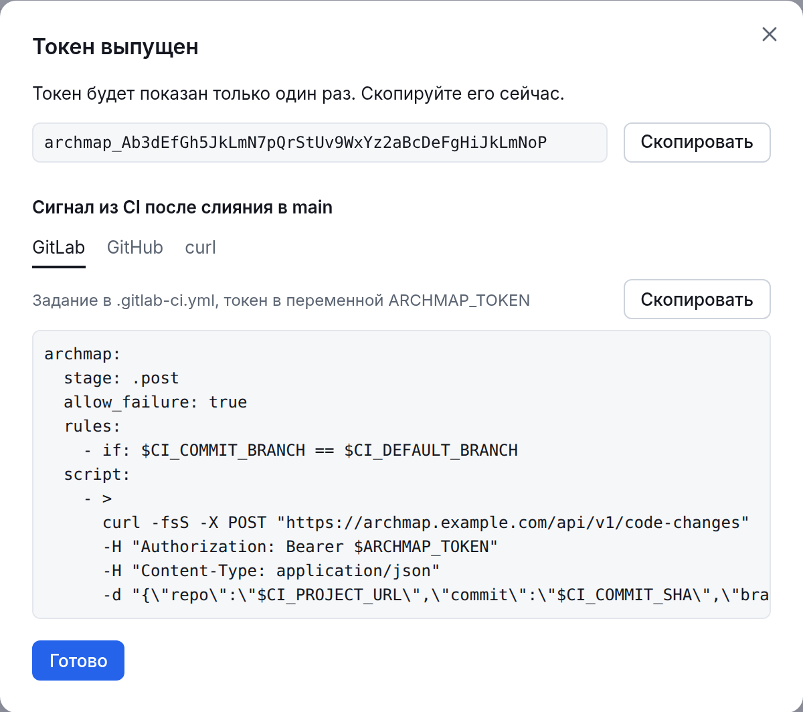

::: note
Пайплайн репозитория может сообщать ArchMap о каждом слиянии в основную ветку. Тогда в проектах, где описан код этого репозитория, появится напоминание о том, что документацию пора обновить (см. [Обновить документацию по напоминанию из CI](../architect/sync.md#reminder)). Саму документацию пайплайн не меняет.
:::

## Выпустить токен для CI {#token}

Чтобы выпустить токен для CI, выполните следующие действия:

1. Войдите в ArchMap под учётной записью администратора.
2. В правом верхнем углу любой страницы нажмите на кружок профиля и выберите **Токены для MCP**. Откроется окно **Токены для MCP**.
3. В списке **Доступ** выберите **Только сигнал из CI**.
4. В списке **Срок действия** выберите, сколько будет действовать токен.
5. Нажмите кнопку **Выпустить токен**. Откроется окно **Токен выпущен**.
6. Справа от токена нажмите **Скопировать**. Окно пока не закрывайте.



::: note
Напоминание получают только проекты, доступные владельцу токена, а администратору доступны все. Читать и менять документацию такой токен не может.
:::

## Добавить задание в пайплайн {#job}

Чтобы пайплайн сообщал ArchMap о слияниях, выполните следующие действия:

1. В настройках CI репозитория создайте секретную переменную `ARCHMAP_TOKEN` и вставьте в неё токен.
2. В окне **Токен выпущен** в разделе **Сигнал из CI после слияния в main** выберите вкладку своей системы CI:
    - **GitLab**: задание для файла `.gitlab-ci.yml`;
    - **GitHub**: workflow для папки `.github/workflows`. Если основная ветка называется не `main`, исправьте её имя в строке `branches`;
    - **curl**: команда для другой системы CI. Подставьте в неё адрес репозитория и хэш коммита.
3. Справа над заданием нажмите **Скопировать** и добавьте задание в пайплайн репозитория.
4. Повторите шаги 1 и 3 в каждом репозитории, код которого описан в ArchMap. Токен у всех репозиториев один.

Задание для GitLab выглядит так:

```yaml
archmap:
  stage: .post
  allow_failure: true
  rules:
    - if: $CI_COMMIT_BRANCH == $CI_DEFAULT_BRANCH
  script:
    - >
      curl -fsS -X POST "https://archmap.example.com/api/v1/code-changes"
      -H "Authorization: Bearer $ARCHMAP_TOKEN"
      -H "Content-Type: application/json"
      -d "{\"repo\":\"$CI_PROJECT_URL\",\"commit\":\"$CI_COMMIT_SHA\",\"branch\":\"$CI_COMMIT_BRANCH\"}"
```

::: note
Задание не останавливает пайплайн: если ArchMap недоступен, остальные этапы пройдут как обычно. Ошибка `returned error: 401` в журнале означает, что токен отозван или истёк либо его владелец заблокирован. Тогда выпустите новый токен и замените значение переменной.
:::

::: note
Исполнитель CI должен открывать адрес ArchMap по сети, а если ArchMap работает по HTTPS с сертификатом внутреннего центра сертификации, ещё и доверять этому центру.
:::

## Проверить, что сигнал доходит {#check}

Чтобы проверить подключение, выполните следующие действия:

1. Слейте любое изменение в основную ветку репозитория и дождитесь задания `archmap`.
2. Откройте журнал задания. В ответе ArchMap перечислены проекты, которым ушло напоминание:

    ```json
    {"repo":"github.com/yarmarka/orders","projects":[{"id":"…","name":"Маркетплейс «Ярмарка»","objects":4}]}
    ```

3. Откройте названный проект в ArchMap. Под шапкой проекта появится строка с адресом репозитория и числом слияний.

::: note
Пустой список `projects` означает, что ни в одном проекте нет объектов с источником в этом репозитории (см. [Найти репозиторий и путь к коду сервиса](../user/source.md)). Источник записывает ИИ-агент, а вручную его можно задать в строке **Источник** свойств объекта (см. [Изменить свойства объекта](../architect/nodes.md#props)).
:::
