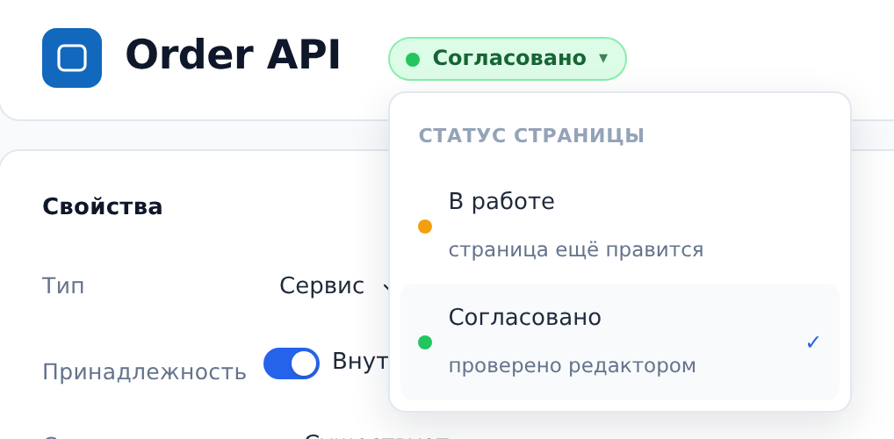
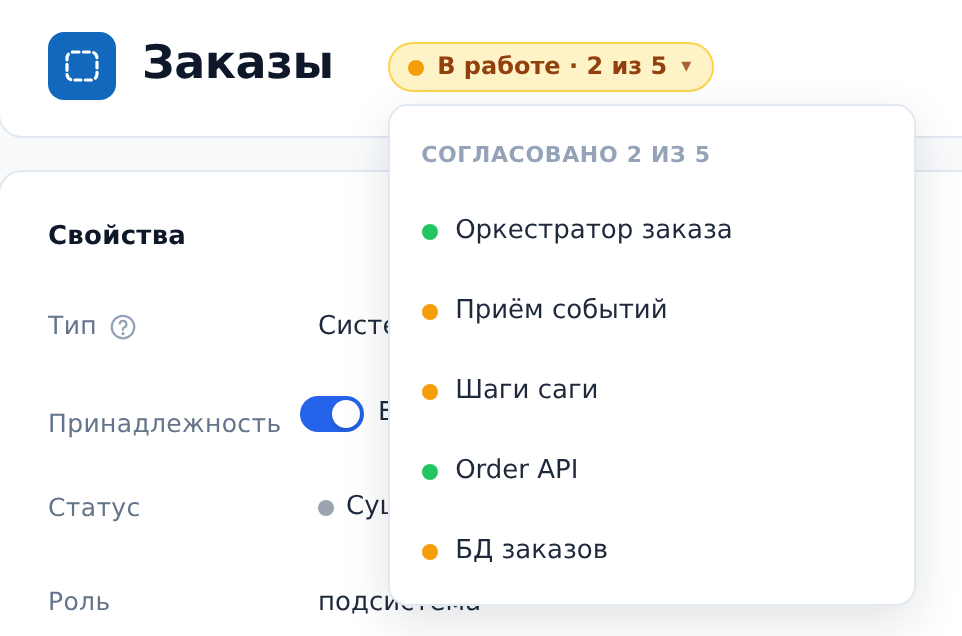

::: note
У каждой страницы объекта есть [статус документации](../glossary.md#status): **В работе** или **Согласовано**. Это статус самой страницы, а не объекта: статусы **Существует**, **Проектируется** и **Выводится** описывают жизненный цикл объекта (см. [Описать планируемые изменения системы](changes.md)). Новые объекты получают статус **В работе**.
:::

## Поставить статус странице

Чтобы поставить статус странице объекта, выполните следующие действия:

1. Откройте страницу объекта. Рядом с именем объекта есть пилюля статуса: жёлтая **В работе** или зелёная **Согласовано**.
2. Нажмите на пилюлю. Раскроется список из двух значений: **В работе** (страница ещё правится) и **Согласовано** (проверено редактором).
3. Выберите статус. Пилюля перекрасится.

::: note
Статус ставит редактор проекта (владелец или редактор). Читатель видит пилюлю без стрелки с подсказкой **Статус меняет редактор проекта**. Правка документации статус не сбрасывает: решение о том, что страница снова в работе, принимает человек.
:::

## Проверить статус системы {#system}

[Система](../glossary.md#system) согласована, когда согласованы все вложенные в неё объекты: контейнеры, компоненты, базы данных и брокеры. Вложенные системы, в том числе внешние, в счёт не идут. Пилюля системы показывает её статус и счётчик, например **В работе · 2 из 5**.

Чтобы найти несогласованные объекты системы, выполните следующие действия:

1. На странице системы нажмите на пилюлю. Раскроется список вложенных объектов, у каждого жёлтая или зелёная точка статуса.
2. Нажмите на строку объекта. Откроется его страница, где статус можно поставить.

::: note
Статус системы складывается из вложенных объектов, поэтому напрямую его не ставят. Список вложенных объектов видит и читатель.
:::

::: note
У внешней системы пилюли нет, потому что статус страницы у неё не ведётся.
:::

## Статус страницы для ИИ-агента

ИИ-агенту по MCP статус доступен так же, как странице: карточка объекта содержит строку **Статус страницы**, а инструмент `archmap_update_node` принимает поле `approval`. Агент меняет статус только по явной просьбе человека (см. [Подключить своего агента через MCP-сервер](mcp.md)).
