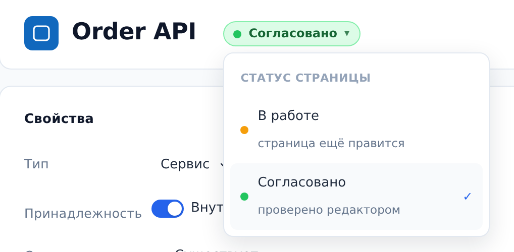
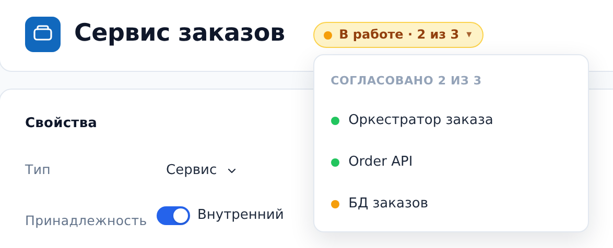

::: note
У каждой страницы объекта есть статус документации: **В работе** или **Согласовано**. Это статус самой страницы, а не объекта: статусы **Существует**, **Проектируется** и **Выводится** описывают жизненный цикл объекта (см. [Описать планируемые изменения системы](changes.md)). Новые объекты получают статус **В работе**.
:::

## Поставить статус странице

Чтобы поставить статус странице объекта, выполните следующие действия:

1. Откройте страницу объекта. Рядом с именем объекта есть пилюля статуса: жёлтая **В работе** или зелёная **Согласовано**.
2. Нажмите на пилюлю. Раскроется список из двух значений: **В работе — страница ещё правится** и **Согласовано — проверено редактором**.
3. Выберите статус. Пилюля перекрасится.

::: note
Статус ставит редактор проекта (владелец или редактор). Читатель видит пилюлю без стрелки с подсказкой **Статус меняет редактор проекта**. Правка документации статус не сбрасывает: решение о том, что страница снова в работе, принимает человек.
:::

## Проверить статус контейнера

Контейнер согласован, когда согласованы все его компоненты, включая внешние объекты и пользователей. Пилюля контейнера показывает его статус и счётчик, например **В работе · 2 из 3**.

Чтобы найти несогласованные компоненты контейнера, выполните следующие действия:

1. На странице контейнера нажмите на пилюлю. Раскроется список компонентов, у каждого жёлтая или зелёная точка статуса.
2. Нажмите на строку компонента. Откроется его страница, где статус можно поставить.

::: note
Поставить статус контейнеру напрямую нельзя: он складывается из компонентов. Список компонентов видит и читатель.
:::

## Статус страницы для ИИ-агента

ИИ-агенту по MCP статус доступен так же, как странице: карточка объекта содержит строку **Статус страницы**, а инструмент `archmap_update_node` принимает поле `approval`. Агент меняет статус только по явной просьбе человека (см. [Подключить своего агента через MCP-сервер](mcp.md)).
