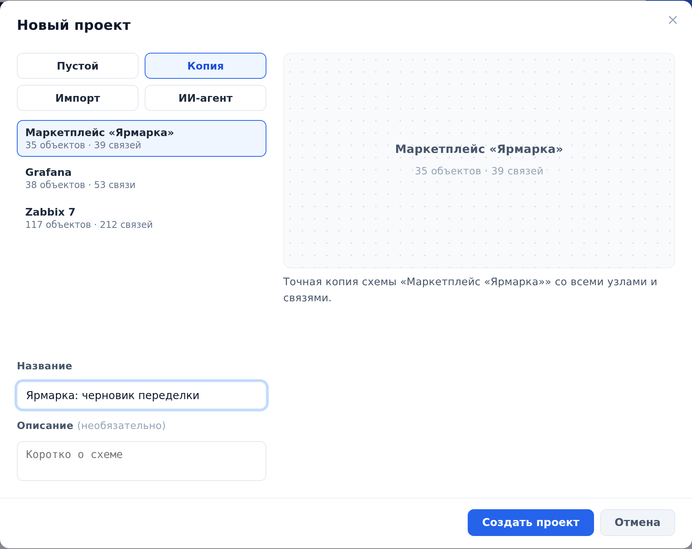

::: note
Создавать проекты может пользователь с общей ролью **Архитектор**, её выдаёт администратор. Создатель становится владельцем проекта. Пока владелец не откроет проект другим (см. [Открыть проект участникам и назначить роли](access.md)), проект видит только он.
:::

::: note
Проект можно создать и из готовых файлов. Способ **Импорт** создаёт проект из файлов YAML и архивов экспорта (см. [Экспортировать и импортировать проект](export-import.md)). Способ **ИИ-агент** создаёт проект по исходному коду системы: ИИ-агент изучает репозиторий и возвращает файл YAML (см. [Импортировать схему, собранную агентом из кода](import-agent.md)).
:::

## Создать пустой проект

Чтобы создать пустой проект, выполните следующие действия:

1. На экране **Проекты** нажмите кнопку **Новый проект**. Откроется окно **Новый проект**.
2. В окне **Новый проект** выберите способ **Пустой**.
3. В поле **Название** введите название проекта.
4. Если нужно, в поле **Описание** коротко опишите систему.
5. Нажмите кнопку **Создать проект**. Откроется страница нового проекта.

::: note
Создать проект можно и из шапки проекта. Для этого нажмите на название проекта и внизу раскрывшегося списка выберите **Новый проект**.
:::

::: note
Описание видно на карточке проекта, по нему работает поиск на экране **Проекты**.
:::

::: note
Наполнить пустой проект можно в редакторе схемы. Чтобы открыть редактор, на странице проекта в разделе **Схема системы** нажмите кнопку **Начать наполнение** (см. [Добавить объекты и контейнеры](nodes.md)).
:::

## Создать копию проекта

Чтобы создать копию проекта, выполните следующие действия:

1. На экране **Проекты** нажмите кнопку **Новый проект**.
2. В окне **Новый проект** выберите способ **Копия**. Появится список проектов.
3. В списке выберите проект, который нужно скопировать.
4. В поле **Название** введите название копии.
5. Нажмите кнопку **Создать проект**. Откроется страница копии.

::: note
В копию переходит всё содержимое проекта: объекты, связи, расположение объектов на схемах, схемы логики, спецификации, структура баз данных, каналы брокеров, параметры конфигурации и бизнес-процессы. Участники не копируются: владелец копии вы, и другим она не видна.
:::

::: note
В списке только активные проекты, доступные вам, в том числе открытые вам только на чтение. Архивный проект перед копированием нужно восстановить (см. [Архивировать, восстановить или удалить проект](archive.md)).
:::

## Изменить название и описание

Чтобы изменить название или описание проекта, выполните следующие действия:

1. На экране **Проекты** на карточке проекта нажмите кнопку **⋯**.
2. В меню выберите пункт **Редактировать**. Откроется окно **Редактировать проект**.
3. Измените название или описание и нажмите кнопку **Сохранить**.

::: note
Пункт **Редактировать** есть только у владельца проекта.
:::
