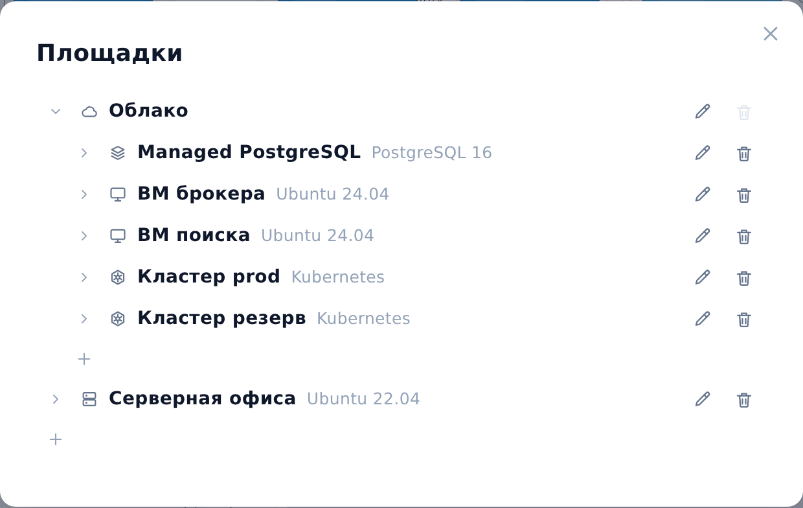
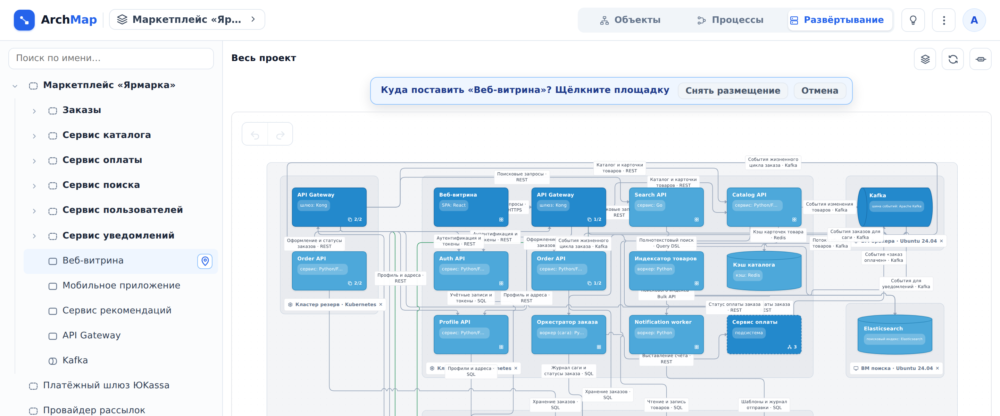

::: note
Размещение описывает, где работает каждый объект: на какой площадке и в скольких экземплярах. Площадки задаются контейнерам, базам данных и брокерам (см. [Глоссарий](../glossary.md#site)). Топология одна на проект, без деления на среды. Как читать схему развёртывания, см. [Посмотреть, где развёрнуты объекты](../user/deployment.md).
:::

## Завести площадки

Чтобы завести площадку, выполните следующие действия:

1. Откройте проект и в шапке в переключателе режимов выберите **Развёртывание**.
2. Над схемой нажмите кнопку **Площадки**. Откроется окно **Площадки** с деревом площадок проекта.
3. Нажмите **+** в нужном месте дерева:
    - под корневыми площадками, если новая площадка корневая;
    - под площадкой, внутри которой лежит новая. Для этого раскройте её стрелкой слева от имени.
4. В форме заполните поля:
    - **Имя**, например «Кластер prod»;
    - **Вид**: **Облако**, **Kubernetes**, **Виртуальная машина**, **Физический сервер** или **Другое**;
    - **Технология**, например «Kubernetes» или «Ubuntu 24.04»;
    - **Описание**.
5. Нажмите кнопку **Добавить**. Площадка появится в дереве.

Чтобы изменить или удалить площадку, выполните следующие действия:

1. В окне **Площадки** наведите курсор на строку площадки. Справа появятся кнопки **Изменить** (карандаш) и **Удалить** (корзина).
2. Выполните одно из действий:
    - нажмите карандаш, поправьте поля и нажмите **Сохранить**;
    - нажмите корзину и в окне **Удалить площадку «…»?** нажмите **Удалить**. Размещение объектов на ней будет снято.

::: note
Площадку с вложенными площадками удалить нельзя. Сначала удалите вложенные или перенесите их в другую площадку полем **Внутри площадки**.
:::

## Поставить объект на площадку щелчком

Чтобы поставить объект на одну площадку, выполните следующие действия:

1. В режиме **Развёртывание** в дереве слева наведите курсор на объект. В строке появится булавка **Указать размещение**.
2. Нажмите булавку. Над схемой появится строка **Куда поставить «…»? Щёлкните площадку**.
3. Выполните одно из действий:
    - на схеме нажмите на нужную площадку. Объект встанет на неё, прежнее размещение снимется;
    - в строке над схемой нажмите **Снять размещение**. Объект уйдёт со всех площадок.

::: note
Поставить объект сразу на несколько площадок можно в окне **Размещение** (см. [Разместить несколько объектов](#разместить-несколько-объектов)).
:::

## Разместить несколько объектов

Чтобы разместить несколько объектов разом, выполните следующие действия:

1. На схеме развёртывания выделите объекты. Для этого нажмите на них с зажатой клавишей Ctrl (⌘ на Mac) или обведите их рамкой.
2. Внизу схемы нажмите кнопку **Указать размещение**. Откроется окно **Размещение** с деревом площадок.
3. Отметьте галочками площадки, где должны стоять объекты. Частичная галочка означает, что площадка есть только у части выбранных; если её не трогать, у каждого объекта она останется как была.
4. Нажмите кнопку **Применить**. Каждый выбранный объект получит ровно отмеченный набор площадок.

::: note
Окно **Размещение** открывается и со страницы объекта. Для этого в разделе **Свойства** в строке **Размещение** нажмите **Изменить**.
:::

## Разместить систему целиком

Чтобы разместить систему, выполните следующие действия:

1. В дереве слева наведите курсор на систему и нажмите булавку **Указать размещение**.
2. На схеме нажмите на нужную площадку. Если часть контейнеров системы стоит на других площадках, откроется вопрос **Разместить «…» на «…»?** со списком этих контейнеров.
3. Нажмите **Разместить**. Все контейнеры системы встанут на выбранную площадку.

::: note
Систему можно разместить и в окне **Размещение**. Отмеченные площадки получат все её контейнеры.
:::

## Поправить расположение на схеме

Чтобы поправить расположение объектов на схеме развёртывания, выполните одно из действий:

- расставьте объекты вручную. Для этого перетащите их;
- над схемой нажмите кнопку **Переразложить**. Объекты встанут по авто-раскладке.

::: note
Перетаскивание не меняет размещение: объект остаётся на своей площадке. Чтобы перенести его на другую, поставьте объект на неё заново.
:::
