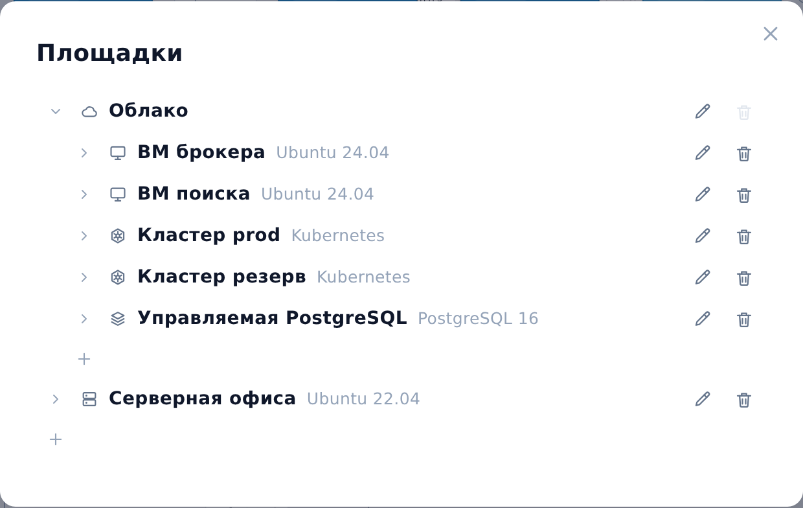
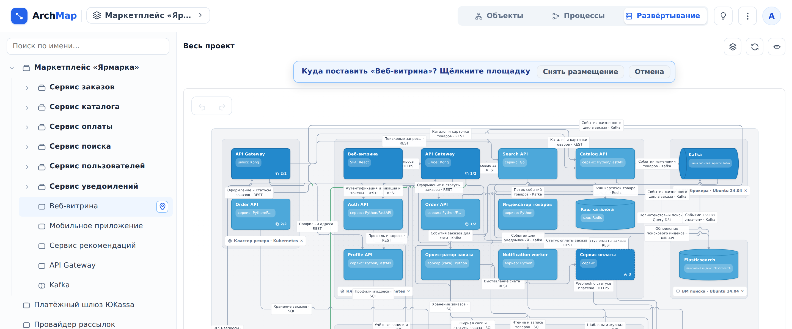
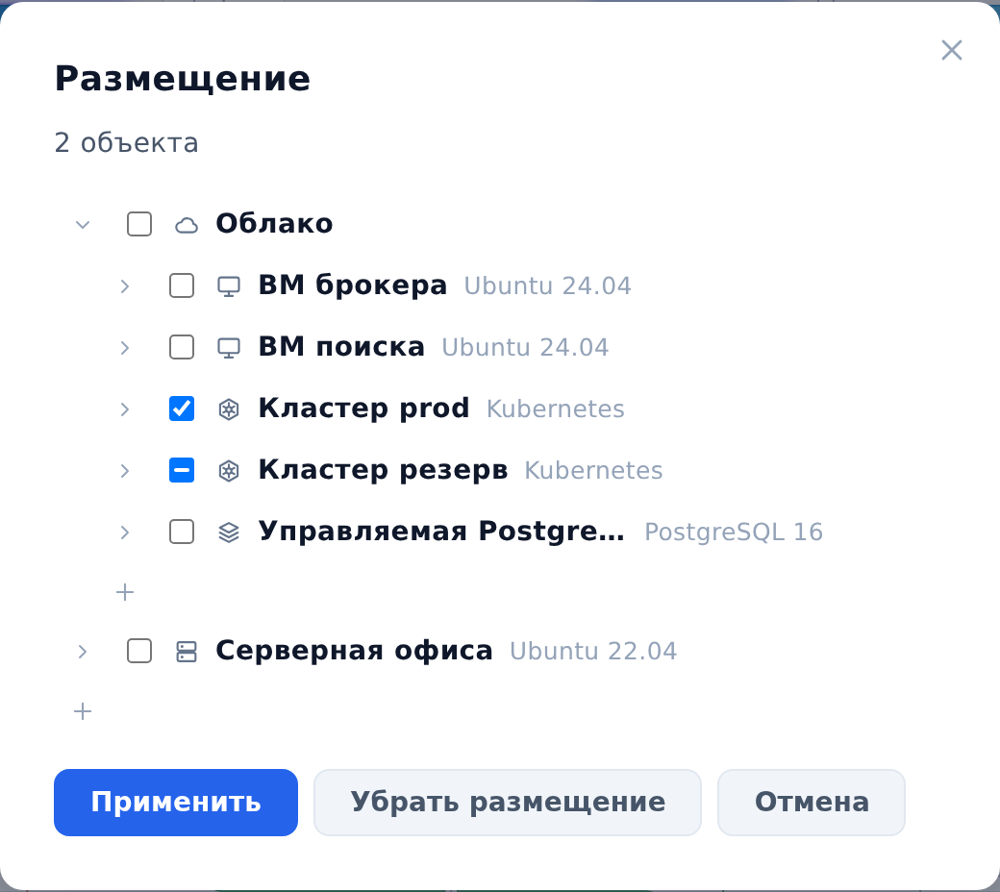

::: note
Размещение описывает, где работает каждый объект: на какой площадке и в скольких экземплярах. Сначала заводят площадки (облако, кластер Kubernetes, виртуальная машина, физический сервер), затем ставят на них объекты. Размещение хранится у объектов: контейнер стоит там, где стоят его компоненты. Топология одна на проект, без деления на среды. Как читать схему развёртывания, см. [Посмотреть, где развёрнуты объекты](../user/deployment.md).
:::

## Завести площадки

Чтобы завести площадку, выполните следующие действия:

1. Откройте проект и в шапке в переключателе режимов выберите **Развёртывание**.
2. Над схемой нажмите кнопку **Площадки**. Откроется окно **Площадки** с деревом площадок проекта.
3. Нажмите **+** одним из способов:
    - под корневыми площадками, чтобы создать корневую площадку;
    - раскройте площадку шевроном и нажмите **+** под ней, чтобы создать площадку внутри неё.
4. В форме заполните поля:
    - **Имя**, например «Кластер prod»;
    - **Вид**: **Облако**, **Kubernetes**, **Виртуальная машина**, **Физический сервер** или **Другое**;
    - **Технология**, например «Kubernetes» или «Ubuntu 24.04»;
    - **Описание**.
5. Нажмите кнопку **Добавить**. Площадка появится в дереве.



Чтобы изменить или удалить площадку, выполните следующие действия:

1. В окне **Площадки** наведите указатель на строку площадки. Справа появятся кнопки **Изменить** (карандаш) и **Удалить** (корзина).
2. Выполните одно из действий:
    - нажмите карандаш, поправьте поля и нажмите **Сохранить**. Поле **Внутри площадки** переносит площадку под другого родителя, значение **Нет, корневая** делает её корневой;
    - нажмите корзину и в окне **Удалить площадку «…»?** нажмите **Удалить**. Размещение объектов на ней будет снято.

::: note
Площадку с вложенными площадками удалить нельзя, пока их не перенесут. Площадки описываются только в интерфейсе: ИИ-агент по MCP площадки не создаёт, но размещает объекты на уже заведённых (см. [Подключить своего агента через MCP-сервер](mcp.md)). В демо-режиме в проекте до 20 площадок.
:::

## Поставить объект на площадку щелчком

Чтобы поставить объект на одну площадку, выполните следующие действия:

1. В режиме **Развёртывание** в дереве слева наведите указатель на объект. В строке появится булавка **Указать размещение**.
2. Нажмите булавку. Над схемой появится строка **Куда поставить «…»? Щёлкните площадку**.
3. На схеме нажмите на зону площадки, на свёрнутую карточку площадки или на карточку объекта, который уже стоит на нужной площадке. Объект встанет на эту площадку и выделится на схеме. Если на текущем уровне его нет, появится сообщение о том, что объект размещён.



::: note
Щелчок ставит объект ровно на одну площадку, прежнее размещение снимается. Поставить объект сразу на несколько площадок можно только окном **Размещение**. Группа **Размещение не указано** площадкой не считается. Кнопка **Снять размещение** в строке над схемой убирает объект со всех площадок, кнопка **Отмена** или клавиша Esc выходит из режима.
:::

## Разместить несколько объектов

Чтобы разместить несколько объектов разом, выполните следующие действия:

1. На схеме развёртывания выделите объекты. Для этого нажмите на их карточки с зажатой клавишей Ctrl (⌘ на Mac) или обведите их рамкой. Внизу схемы появится панель **Выбрано N объектов**.
2. Нажмите кнопку **Указать размещение**. Откроется окно **Размещение** с деревом площадок.
3. Отметьте галочками площадки, где должны стоять объекты. Частичная галочка означает, что площадка есть только у части выбранных; если её не трогать, у каждого объекта она останется как была. Новую площадку можно создать здесь же кнопкой **+**.
4. Нажмите кнопку **Применить**. Каждый выбранный объект получит ровно отмеченный набор площадок.



::: note
Кнопка **Убрать размещение** снимает все площадки у выбранных объектов после вопроса **Снять размещение выбранных объектов?**. Окно **Размещение** открывается и со страницы объекта: в разделе **Свойства** в строке **Размещение** нажмите **Изменить**.
:::

## Разместить контейнер целиком

Контейнер размещается целиком: отмеченные для него площадки получают все его компоненты, а сам контейнер стоит там, где стоят его компоненты. Если у части компонентов размещение на других площадках, перед записью ArchMap задаст вопрос **Разместить «…» на «…»?** со списком компонентов и их площадок. Нажмите **Разместить**, чтобы перенести все компоненты, или **Отмена**.

::: note
В окне **Размещение** галочки контейнера показывают размещение его компонентов: частичная галочка означает, что на площадке стоит только часть. **Снять размещение** у контейнера снимает его у всех компонентов после такого же вопроса со списком. На странице контейнера в строке **Размещение** площадка части компонентов помечена **часть объектов**.
:::

## Поправить схему

Карточки на схеме развёртывания двигаются перетаскиванием только внутри своей площадки, зона подстраивается под свои карточки. Чтобы перенести объект на другую площадку, используйте булавку или окно **Размещение**. Чтобы разложить уровень заново, над схемой нажмите кнопку **Переразложить**: карточки встанут по авто-раскладке, а свёрнутые площадки останутся свёрнутыми.

## Размещение в YAML и для ИИ-агента

В YAML проекта размещение описано текстом: после связей идёт раздел `deployment` со списком площадок, а у объекта поле `sites` с именами площадок (см. [Экспортировать и импортировать проект](export-import.md)).

```yaml
deployment:
  sites:
    - name: Облако
      kind: cloud
    - name: Кластер prod
      kind: kubernetes
      technology: Kubernetes
      parent: Облако
    - name: Кластер резерв
      kind: kubernetes
      parent: Облако
nodes:
  - name: Сервис заказов
    shape: service
    children:
      - name: Order API
        sites: [Кластер prod, Кластер резерв]
```

::: note
Контейнер, все компоненты которого стоят на одном наборе площадок, записывает `sites` сам, а его компоненты поле не повторяют. При импорте объявление контейнера получают его компоненты. Если проект собирается из нескольких файлов, площадки с одинаковым именем считаются одной (см. [Объединить файлы из нескольких репозиториев в один проект](merge-repos.md)). Синхронизация с прогоном агента размещение не меняет (см. [Обновить схему после изменений в коде](sync.md)).
:::

ИИ-агенту по MCP размещение доступно так же, как панели: карточка объекта содержит строку **Размещение**, инструмент `archmap_update_node` принимает список `sites`, а `archmap_deployment` отдаёт дерево площадок с объектами и список объектов без размещения (см. [Подключить своего агента через MCP-сервер](mcp.md)).
