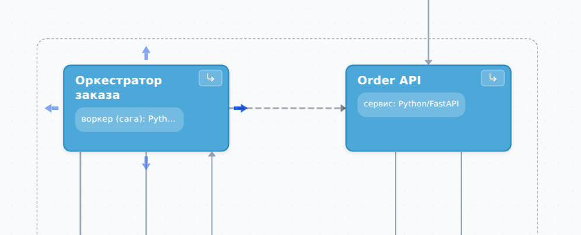

::: note
Связь направлена от объекта, который обращается, к объекту, к которому обращаются (например, от сервиса к его базе данных). Добавить связь можно в редакторе схемы (см. [Открыть редактор схемы](nodes.md#editor)).
:::

## Добавить связь на схеме

Чтобы добавить связь, выполните следующие действия:

1. В редакторе схемы наведите курсор на объект, от которого идёт связь. По сторонам объекта появятся стрелки.
2. Проведите связь одним из способов:
    - потяните любую стрелку и отпустите её на объекте, к которому идёт связь;
    - наведите курсор на стрелку и, если пунктир от неё ведёт к нужному объекту, нажмите на стрелку.

    Откроется окно **Новая связь**.
3. В поле **Описание** коротко опишите, зачем обращаются (например, «Оформление заказа»).
4. В поле **Технология** укажите протокол или технологию (например, REST или Kafka).
5. Нажмите кнопку **Создать связь**. Связь появится на схеме.

::: note
Сторона, за которую тянули стрелку, не влияет на то, как линия ляжет на схеме, потому что путь линии ArchMap прокладывает сам.
:::

::: note
Если отпустить стрелку на пустом месте схемы, связь не создастся.
:::

## Связать объект с объектом внутри системы или контейнера {#into}

Чтобы связать объект с объектом внутри системы или контейнера, выполните следующие действия:

1. В редакторе схемы потяните стрелку объекта и отпустите её на системе или контейнере. Откроется окно **Связь внутрь «…»** со списком вложенных объектов.
2. В списке выберите объект, к которому идёт связь (например, компонент контейнера).
3. Заполните поля **Описание** и **Технология**.
4. Нажмите кнопку **Создать связь**.

::: note
Когда стрелку отпускают на системе или контейнере, ArchMap всегда предлагает выбрать объект внутри, потому что обращаются к конкретной части системы или контейнера. Если связь провели раньше к объекту, который потом стал системой или контейнером, её конец можно перенести на вложенный объект (см. [Изменить или удалить связь](#edit)).
:::

## Связать объект с объектом на другом уровне

Чтобы связать объект с объектом, которого нет на текущем уровне, выполните следующие действия:

1. В редакторе схемы потяните стрелку объекта. Вверху схемы появится полоса **Объект вне уровня**.
2. Отпустите стрелку на полосе. Откроется окно **Связь с объектом вне уровня**.
3. Найдите объект, к которому идёт связь, и выберите его.
4. Заполните поля **Описание** и **Технология**.
5. Нажмите кнопку **Создать связь**.

::: note
На корневом уровне полосы **Объект вне уровня** нет, потому что остальные объекты проекта лежат внутри систем и контейнеров этого уровня. Чтобы связать объект с одним из них, отпустите стрелку на системе или контейнере, в котором он лежит (см. [Связать объект с объектом внутри системы или контейнера](#into)).
:::

## Изменить или удалить связь {#edit}

Чтобы изменить или удалить связь в редакторе схемы, выполните следующие действия:

1. Дважды нажмите на линию связи или её подпись. Справа откроется панель связи.
2. Если на линию легли несколько связей, сначала откроется окно **Выберите связь**. В шапке окна указаны концы линии. Нажмите на нужную связь. Если концы у связей разные, под описанием каждой указан объект на её конце (например, **→ Каталог**).
3. Измените нужные поля. Изменение сохраняется, когда вы переходите к другому полю.
4. Чтобы удалить связь, нажмите кнопку **Удалить связь**.

::: note
Если связь ведёт к брокеру или от него, в поле **Канал** укажите топик или очередь. Если такого канала нет в разделе **Каналы** брокера, под полем появится предупреждение (см. [Описать каналы брокера](channels.md)).
:::

::: note
Изменение или удаление связи в редакторе можно отменить клавишами <kbd>Ctrl</kbd>+<kbd>Z</kbd> (см. [Отменить действие](nodes.md#отменить-действие)).
:::

Чтобы изменить или удалить связь на странице объекта, выполните следующие действия:

1. На странице объекта в разделе **Связи** нажмите на строку связи:
    - если в строке одна связь, откроется окно **Редактирование связи**;
    - если в строке несколько связей (после описания стоит их число, например, **×10**), откроется окно **Выберите связь**. Нажмите в нём на связь с нужным объектом (например, **→ Каталог**). Откроется окно **Редактирование связи**.
2. Измените нужные поля. Кнопка **Развернуть направление** меняет концы связи местами.
3. Нажмите кнопку **Готово**.
4. Чтобы удалить связь, нажмите кнопку **Удалить** и подтвердите удаление.

::: note
Изменения на странице объекта отменить нельзя.
:::
