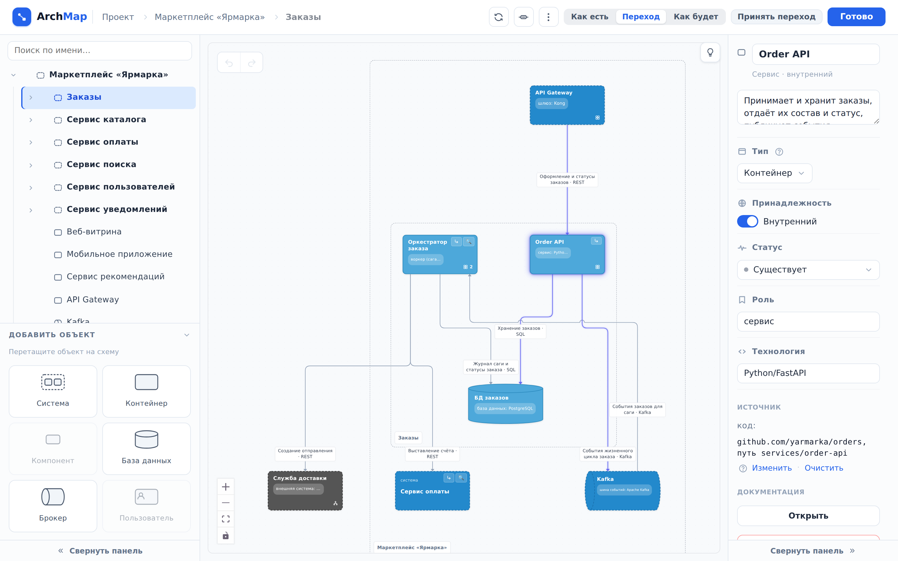
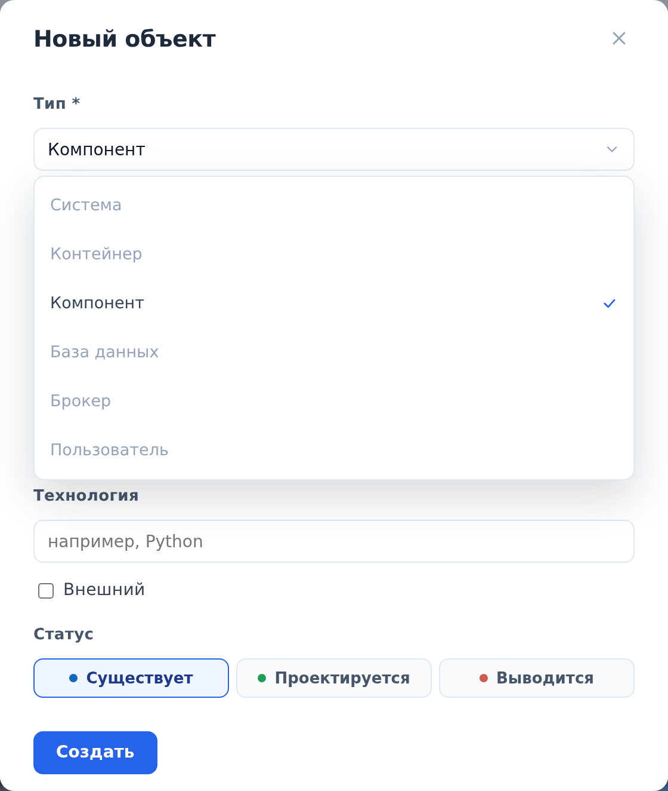

::: note
Добавить объекты и связи можно в редакторе схемы. Редактор показывает один уровень схемы: верхний уровень проекта или содержимое одной системы или одного контейнера. Каждый объект создаётся с типом: [система](../user/glossary.md#system), [контейнер](../user/glossary.md#container), [компонент](../user/glossary.md#component), база данных, брокер или пользователь. От типа зависит, какая документация будет у объекта и где он может лежать.
:::

## Открыть редактор схемы {#editor}

Чтобы открыть редактор схемы, нажмите кнопку **Редактировать** над схемой одним из способов:

- на странице проекта в разделе **Схема системы**. Редактор откроется на корневом уровне;
- на странице объекта в разделе **Схема**. Редактор откроется на уровне, где лежит объект, и подсветит его.

::: note
В пустом проекте кнопки **Редактировать** нет. Вместо неё в разделе **Схема системы** нажмите кнопку **Начать наполнение**.
:::

::: note
Кнопка **Готово** в правом верхнем углу закрывает редактор и возвращает на страницу, с которой он открыт.
:::

## Добавить объект {#add}

Чтобы добавить объект, выполните следующие действия:

1. В редакторе схемы перейдите на уровень, куда нужно добавить объект. Для этого в дереве слева нажмите на систему или контейнер. На корневой уровень ведёт ссылка **Проект** в пути вверху страницы.
2. В разделе **Добавить объект** слева перетащите на схему плитку нужного типа. Откроется окно **Новый объект**, в поле **Тип** будет выбран тип плитки.
3. Если нужно, в поле **Тип** выберите другой тип. Серые пункты списка означают типы, которых в этом месте не бывает.
4. В поле **Название** введите имя объекта.
5. Если нужно, заполните поля **Описание**, **Роль** и **Технология**.
6. Если объект не принадлежит к вашей системе (например, это смежный продукт или сторонний провайдер), включите флажок **Внешний**.
7. Нажмите кнопку **Создать**. Объект появится на схеме там, куда вы перетащили плитку.

::: note
Серая плитка означает, что объект этого типа на текущий уровень положить некуда. Подсказка на плитке объясняет, где такой объект создаётся: например, компонент создаётся внутри контейнера, а пользователь создаётся на верхнем уровне проекта, потому что находится вне системы. Плитка **Компонент** на уровне системы становится активной, если на схеме раскрыт контейнер: перетащите её в рамку контейнера, подходящие рамки подсветятся зелёным.
:::

::: note
Если окно **Новый объект** открыто без плитки (например, кнопкой **+** в дереве), тип предлагается по месту: внутри контейнера **Компонент**, в остальных местах тип последнего созданного рядом объекта. Если предложить нечего, кнопка **Создать** неактивна, пока тип не выбран.
:::

::: note
У объекта из старого проекта или из файла агента тип может быть не выбран. Если вы создаёте первый вложенный объект внутри такого объекта, под полем **Тип** появится строка о том, кем он станет: при типе **Компонент** родитель станет контейнером, при любом другом типе родитель станет системой.
:::

::: note
Роль и технология отображаются на схеме под именем объекта (например, «сервис: Python/FastAPI»). Обе строки заполняются свободным текстом, поэтому пишите так, как принято в вашей команде.
:::

::: note
Поле **Статус** нужно для планируемых изменений: **Проектируется** отмечает новый объект, **Выводится** отмечает объект, который уберут (см. [Описать планируемые изменения системы](changes.md)).
:::

## Добавить компонент в контейнер

Чтобы добавить компонент в контейнер, выполните следующие действия:

1. В редакторе схемы откройте окно **Новый объект** одним из способов:
    - в дереве слева наведите курсор на контейнер и нажмите кнопку **+** справа от его имени;
    - на схеме нажмите кнопку **Войти к компонентам** в правом верхнем углу контейнера (у контейнера без компонентов она называется **Войти**). Откроется уровень контейнера. Перетащите на схему плитку **Компонент** из раздела **Добавить объект**;
    - если контейнер раскрыт на схеме лупой, перетащите плитку **Компонент** в его рамку.
2. В окне **Новый объект** в поле **Тип** уже выбран **Компонент**. Заполните поля и нажмите кнопку **Создать**. Компонент появится в дереве внутри контейнера.

::: note
Внутри контейнера бывают только компоненты. База данных и брокер, с которыми работает контейнер, создаются рядом с ним, на уровне системы.
:::

::: note
Схемы логики описывают код компонентов. Если у контейнера уже были свои схемы логики, когда в нём появились компоненты, они останутся у контейнера, а на его странице в разделе **Логика** появится кнопка **Перенести документацию**. В окне этой кнопки выберите для каждой схемы компонент, которому она перейдёт.
:::

## Изменить свойства объекта {#props}

Чтобы изменить свойства объекта, выполните следующие действия:

1. В редакторе схемы дважды нажмите на объект. Справа откроется панель его свойств.
2. Измените нужные поля. Изменение сохраняется, когда вы переходите к другому полю.

::: note
Те же свойства можно изменить на странице объекта в разделе **Свойства**.
:::

::: note
У системы технология собирается из технологий вложенных объектов, поэтому её поле **Технология** только для чтения. У остальных объектов технологию задают вручную.
:::

## Изменить тип объекта {#type}

Чтобы изменить тип объекта, выполните следующие действия:

1. В редакторе схемы дважды нажмите на объект. Справа откроется панель его свойств.
2. В строке **Тип** выберите новый тип. Серые пункты списка означают типы, которых у объекта в этом месте не бывает: например, объект внутри контейнера всегда компонент, а объект с вложенными объектами не становится базой данных, брокером или пользователем.
3. Если смена типа меняет площадки или документацию, откроется окно с вопросом, например **Сделать «…» контейнером?**. В нём перечислено, что станет с вложенными объектами, площадки до и после смены и что будет с документацией. Нажмите кнопку подтверждения (например, **Сделать контейнером**) или **Отмена**.

::: note
Тип можно изменить и на странице объекта в разделе **Свойства** в строке **Тип**. Знак **?** рядом со строкой объясняет, чем отличаются система, контейнер и компонент (см. [Глоссарий](../user/glossary.md#object)).
:::

::: note
Смена типа, после которой открывалось окно с вопросом, не отменяется клавишами <kbd>Ctrl</kbd>+<kbd>Z</kbd>. Чтобы вернуть прежний тип, смените его обратно тем же способом.
:::

## Перенести объект в другую систему или контейнер {#move}

Чтобы перенести объект, выполните следующие действия:

1. В редакторе схемы в дереве слева наведите курсор на объект. Слева от имени появится ручка переноса.
2. Перетащите объект за ручку на строку системы или контейнера, в который его нужно перенести. Чтобы вынести объект на корневой уровень, перетащите его на полосу **В корень проекта**. Она появится вверху дерева, когда вы начнёте перетаскивать.
3. Если откроется окно с вопросом, ответьте на него:
    - **Что такое «…» внутри «…»?** появляется, когда вы переносите объект в объект без вложенных объектов и без выбранного типа. Выберите **Компонент**, если переносимый объект — часть кода родителя (родитель станет контейнером), или **Отдельное приложение** (родитель станет системой), и нажмите **Продолжить**;
    - окно с последствиями, например **Сделать «…» частью «…»?**, появляется, когда перенос меняет площадки: объект входит в контейнер и становится компонентом или выходит из контейнера. Нажмите **Перенести** или **Отмена**.

::: note
Объект переносится вместе с вложенными объектами, связями и документацией. Перенос, после которого открывалось окно с последствиями, не отменяется клавишами <kbd>Ctrl</kbd>+<kbd>Z</kbd>.
:::

::: note
Пользователь находится вне системы, поэтому переносится только на корневой уровень. Строка контейнера не принимает базу данных и брокер, потому что в контейнер они не входят. Перенесите их на строку системы, рядом с контейнером, который с ними работает.
:::

## Удалить объект

Чтобы удалить объект, выполните следующие действия:

1. В редакторе схемы выделите объект. Для этого нажмите на него.
2. Нажмите клавишу <kbd>Delete</kbd>.
3. Если у объекта есть связи, вложенные объекты или документация, откроется окно со списком того, что удалится вместе с ним. Нажмите кнопку **Да, удалить**.

::: note
Удалить объект можно и кнопкой **Удалить объект** в панели свойств.
:::

::: note
Чтобы удалить несколько объектов, выделите их одним из способов:

- обведите объекты рамкой, зажав левую кнопку мыши на пустом месте схемы;
- нажимайте на объекты, удерживая <kbd>Ctrl</kbd>.
:::

::: note
Удалить объект можно и на его странице. Для этого в меню **⋯** рядом с названием выберите пункт **Удалить объект**. Такое удаление отменить нельзя.
:::

## Отменить действие

Чтобы отменить последнее действие в редакторе схемы, выполните одно из действий:

- нажмите <kbd>Ctrl</kbd>+<kbd>Z</kbd>;
- в левом верхнем углу схемы нажмите кнопку **Отменить**.

::: note
Чтобы вернуть отменённое действие, нажмите <kbd>Ctrl</kbd>+<kbd>Shift</kbd>+<kbd>Z</kbd> или кнопку **Вернуть** рядом с кнопкой **Отменить**.
:::

::: note
Отмена возвращает удалённый объект целиком: с вложенными объектами, связями и документацией. Действия можно отменять, пока редактор открыт; после нажатия **Готово** история действий сбрасывается.
:::
