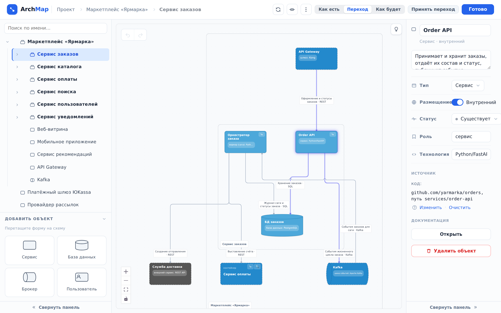

::: note
Добавить объекты и связи можно в редакторе схемы. Редактор показывает один уровень схемы: корень проекта или содержимое одного контейнера. Контейнером в ArchMap называется сервис, у которого есть дочерние компоненты.
:::

## Открыть редактор схемы {#editor}

Чтобы открыть редактор схемы, нажмите кнопку **Редактировать** над схемой одним из способов:

- на странице проекта в разделе **Схема системы**. Редактор откроется на корневом уровне;
- на странице объекта в разделе **Схема**. Редактор откроется на уровне, где лежит объект, и подсветит его.

::: note
В пустом проекте кнопки **Редактировать** нет. Вместо неё в разделе **Схема системы** нажмите кнопку **Начать наполнение**.
:::

::: note
Кнопка **Готово** в правом верхнем углу закрывает редактор и возвращает на страницу, с которой он открыт.
:::

## Добавить объект {#add}

Чтобы добавить объект, выполните следующие действия:

1. В редакторе схемы перейдите на уровень, куда нужно добавить объект. Для этого в дереве слева нажмите на контейнер. На корневой уровень ведёт ссылка **Проект** в пути вверху страницы.
2. В разделе **Добавить объект** слева перетащите на схему форму нового объекта. Откроется окно **Новый объект**.
3. В поле **Название** введите имя объекта.
4. Если нужно, заполните поля **Описание**, **Роль** и **Технология**.
5. Если объект не принадлежит к вашей системе (например, это смежная система или сторонний провайдер), включите флажок **Внешний**.
6. Нажмите кнопку **Создать**. Объект появится на схеме там, куда вы перетащили форму.

::: note
Роль и технология отображаются на схеме под именем объекта (например, «сервис: Python/FastAPI»). Обе строки свободные: пишите так, как принято в вашей команде.
:::

::: note
Поле **Статус** нужно для планируемых изменений: **Проектируется** отмечает новый объект, **Выводится** отмечает объект, который уберут (см. [Описать планируемые изменения системы](changes.md)).
:::

## Добавить компонент в сервис

Чтобы добавить компонент в сервис, выполните следующие действия:

1. В редакторе схемы откройте окно **Новый объект** одним из способов:
    - в дереве слева наведите курсор на сервис и нажмите кнопку **+** справа от его имени;
    - если у сервиса уже есть дочерние компоненты, в дереве слева нажмите на сервис и перетащите на схему форму нового объекта из раздела **Добавить объект**;
    - на схеме нажмите кнопку **Войти** в правом верхнем углу сервиса. Откроется уровень сервиса с его рамкой (у сервиса без компонентов она пустая). Перетащите в рамку форму нового объекта из раздела **Добавить объект**.
2. Заполните поля и нажмите кнопку **Создать**. Компонент появится в дереве внутри сервиса. Если у родительского сервиса ещё не было дочерних компонентов, он станет контейнером.

::: note
Кнопка **+** создаёт компонент с формой **Сервис**. Форму можно сменить в панели свойств (см. [Изменить свойства объекта](#props)).
:::

::: note
Компоненты бывают только у сервисов. База данных, брокер и пользователь контейнерами не становятся.
:::

::: note
У контейнера нет своих схем логики и спецификаций. Если у сервиса уже были схемы логики, после появления дочерних компонентов они продолжат принадлежать ему, но на его странице появится кнопка **Распределить по детям**. С её помощью можно привязать документацию к дочерним компонентам.
:::

## Изменить свойства объекта {#props}

Чтобы изменить свойства объекта, выполните следующие действия:

1. В редакторе схемы дважды нажмите на объект. Справа откроется панель его свойств.
2. Измените нужные поля. Изменение сохраняется, когда вы переходите к другому полю.

::: note
Те же свойства можно изменить на странице объекта в разделе **Свойства**.
:::

::: note
Технология контейнера собирается из технологий его компонентов, вручную её изменить нельзя.
:::

## Перенести объект в другой контейнер

Чтобы перенести объект, выполните следующие действия:

1. В редакторе схемы в дереве слева наведите курсор на объект. Слева от имени появится ручка переноса.
2. Перетащите объект за ручку на строку сервиса, в который его нужно перенести. Чтобы вынести объект на корневой уровень, перетащите его на полосу **В корень проекта**: она появится вверху дерева, когда вы начнёте перетаскивать.

::: note
Объект переносится вместе с компонентами, связями и документацией. Пользователя можно вынести только на корневой уровень.
:::

## Удалить объект

Чтобы удалить объект, выполните следующие действия:

1. В редакторе схемы выделите объект. Для этого нажмите на него.
2. Нажмите клавишу <kbd>Delete</kbd>.
3. Если у объекта есть связи, компоненты или документация, откроется окно со списком того, что удалится вместе с ним. Нажмите кнопку **Да, удалить**.

::: note
Удалить объект можно и кнопкой **Удалить объект** в панели свойств.
:::

::: note
Чтобы удалить несколько объектов, выделите их одним из способов:

- потяните мышью по пустому месту схемы: выделятся объекты, которые заденет рамка;
- нажимайте на объекты, удерживая <kbd>Ctrl</kbd>.
:::

::: note
Удалить объект можно и на его странице: в меню **⋯** рядом с названием выберите пункт **Удалить объект**. Такое удаление отменить нельзя.
:::

## Отменить действие

Чтобы отменить последнее действие в редакторе схемы, выполните одно из действий:

- нажмите <kbd>Ctrl</kbd>+<kbd>Z</kbd>;
- в левом верхнем углу схемы нажмите кнопку **Отменить**.

::: note
Чтобы вернуть отменённое действие, нажмите <kbd>Ctrl</kbd>+<kbd>Shift</kbd>+<kbd>Z</kbd> или кнопку **Вернуть** рядом с кнопкой **Отменить**.
:::

::: note
Отмена возвращает удалённый объект целиком: с компонентами, связями и документацией. Действия можно отменять, пока редактор открыт; после нажатия **Готово** история действий сбрасывается.
:::
