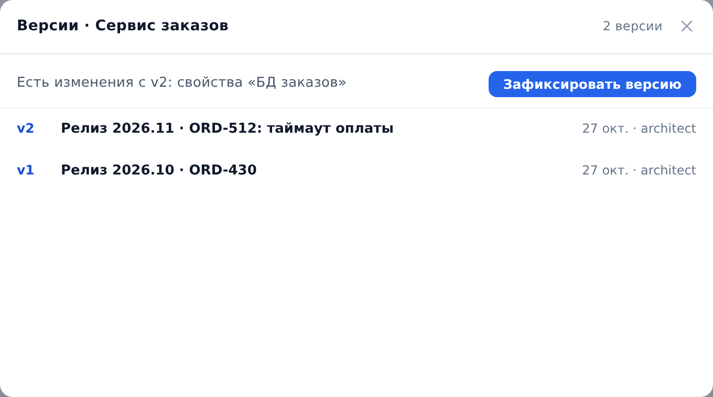
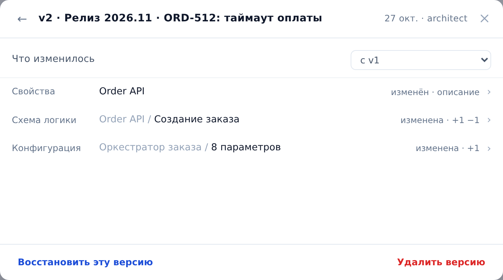
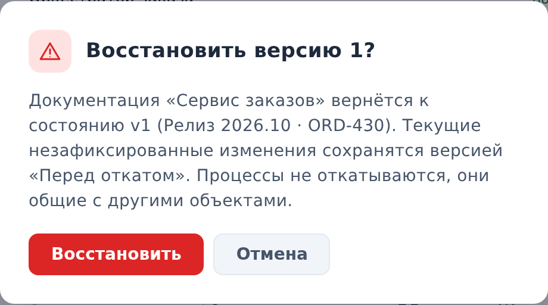

::: note
Версия документации — это срез документации объекта на момент фиксации: свойства, статус страницы, связи, схемы логики, спецификация OpenAPI, структура базы, каналы, конфигурация, участие в процессах и размещение. У контейнера в срез входит всё его поддерево, у проекта вся документация. Версии хранятся в ArchMap: к любой из них можно вернуться, а изменения между версиями посмотреть по элементам.
:::

## Зафиксировать версию

Чтобы зафиксировать версию документации, выполните следующие действия:

1. Откройте страницу объекта. Для версии всего проекта откройте страницу проекта.
2. Справа от имени нажмите кнопку **⋯** и выберите **Версии документации**. Откроется панель **Версии документации** со списком версий: номер, комментарий, дата и автор.
3. Над списком в строке **Есть изменения с vN: …** нажмите кнопку **Зафиксировать версию**. Откроется окно с полем комментария.
4. Введите комментарий, например номер релиза или задачи, и нажмите кнопку **Зафиксировать**. В списке появится новая версия.

::: note
Комментарий обязателен: по нему версию потом находят. Если изменений с последней версии нет, над списком написано **Изменений с vN нет**, и фиксировать нечего. В демо-режиме в проекте до 30 версий.
:::

## Посмотреть, что изменилось

Чтобы посмотреть изменения, выполните следующие действия:

1. В панели **Версии документации** нажмите на версию. Откроется экран версии с заголовком **vN · комментарий** и списком изменённых элементов: свойства, статус страницы, связь, схема логики, OpenAPI, таблица, канал, конфигурация, процесс, размещение.
2. В поле **С чем сравнивать** выберите, что показать:
    - **с vN−1**: что изменилось в этой версии по сравнению с предыдущей;
    - **с текущим состоянием**: что изменит возврат к этой версии.
3. Нажмите на элемент. Откроется экран элемента с переключателем **Изменения · Было · Стало**.
4. Чтобы вернуться на предыдущий экран, нажмите кнопку **Назад**.

## Вернуться к версии

Чтобы вернуть документацию к версии, выполните следующие действия:

1. На экране версии нажмите кнопку **Восстановить эту версию**. Откроется окно **Восстановить версию N?**. В нём написано, что произойдёт: незафиксированные изменения сохранятся версией **Перед откатом**, объекты, появившиеся после версии N, будут удалены (указано их число), бизнес-процессы не откатываются.
2. Нажмите кнопку **Восстановить**. Документация вернётся к версии N, а в списке появятся две автоматические версии: **Перед откатом к vN** и **Откат к vN**.

::: note
История идёт только вперёд: возврат не удаляет версии, а добавляет новые. Бизнес-процессы и статус страницы возврат не меняет. Кнопка **Восстановить эту версию** недоступна, если версия последняя и изменений с неё нет.
:::

## Удалить версию

Чтобы удалить версию, на её экране нажмите кнопку **Удалить версию** и в окне **Удалить версию N?** нажмите **Удалить**. Остальные номера не меняются.

::: note
Удалять версии может только владелец проекта.
:::

## Версии для читателя и ИИ-агента

Читатель открывает ту же панель через **⋯** → **Версии документации**, смотрит список, изменения и старые версии, но зафиксировать версию или вернуться к ней не может (см. [Посмотреть прежние версии документации](../user/versions.md)).

ИИ-агенту по MCP доступны список версий, сравнение и текст документации на версии (инструменты `archmap_versions`, `archmap_version_diff` и `archmap_version_doc`), а зафиксировать версию он может инструментом `archmap_version_create` только по явной просьбе человека. Возврата к версии у агента нет (см. [Подключить своего агента через MCP-сервер](mcp.md)).
