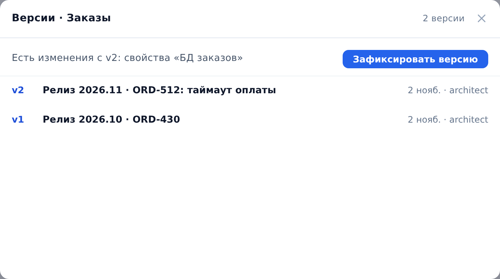
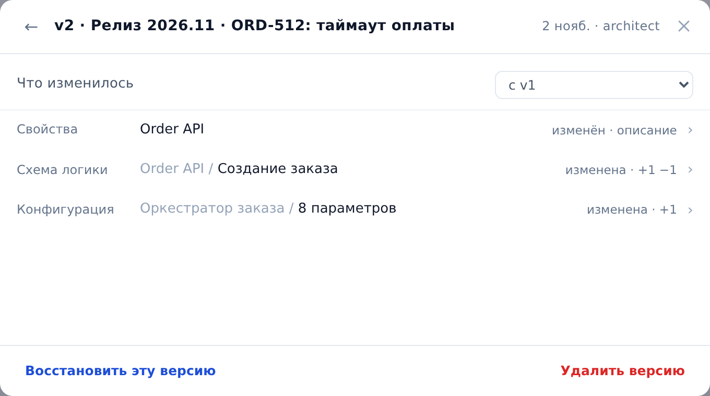
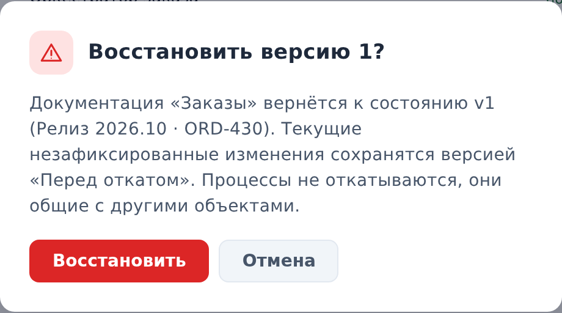

::: note
[Версия документации](../glossary.md#version) — это срез документации объекта на момент фиксации. В версию объекта входит и документация всех вложенных в него объектов, а в версию проекта вся документация проекта. Версии хранятся в ArchMap: к любой из них можно вернуться, а изменения между версиями посмотреть по элементам.
:::

## Зафиксировать версию

Чтобы зафиксировать версию документации, выполните следующие действия:

1. Откройте страницу объекта. Для версии всего проекта откройте страницу проекта.
2. Справа от имени нажмите кнопку **⋯** и выберите **Версии документации**. Откроется список версий.
3. Над списком в строке **Есть изменения с vN: …** нажмите кнопку **Зафиксировать версию**. Откроется окно с полем комментария.
4. Введите комментарий, например номер релиза или задачи, и нажмите кнопку **Зафиксировать**. В списке появится новая версия.

::: note
Комментарий обязателен, потому что по нему версию потом находят. Если изменений с последней версии нет, над списком написано **Изменений с vN нет**, и фиксировать нечего.
:::

## Посмотреть, что изменилось

Чтобы посмотреть изменения, выполните следующие действия:

1. В списке версий нажмите на версию. Откроется экран версии со списком изменённых элементов.
2. В поле **С чем сравнивать** выберите, что показать:
    - **с vN−1**: что изменилось в этой версии по сравнению с предыдущей;
    - **с текущим состоянием**: что изменит возврат к этой версии.
3. Нажмите на элемент. Откроется экран элемента с переключателем **Изменения · Было · Стало**.
4. Чтобы вернуться на предыдущий экран, нажмите кнопку **Назад**.

## Вернуться к версии

Чтобы вернуть документацию к версии, выполните следующие действия:

1. На экране версии нажмите кнопку **Восстановить эту версию**. Откроется окно **Восстановить версию N?** с последствиями возврата. Проверьте их: объекты, появившиеся после версии N, будут удалены.
2. Нажмите кнопку **Восстановить**. Документация вернётся к версии N, а в списке появятся две автоматические версии: **Перед откатом к vN** и **Откат к vN**.

::: note
История идёт только вперёд: возврат не удаляет версии, а добавляет новые. Бизнес-процессы и статус страницы возврат не меняет.
:::

## Удалить версию

Чтобы удалить версию, выполните следующие действия:

1. На экране версии нажмите кнопку **Удалить версию**. Откроется окно **Удалить версию N?**.
2. Нажмите **Удалить**. Версия пропадёт из списка, номера остальных версий не изменятся.

::: note
Удалять версии может только владелец проекта.
:::
