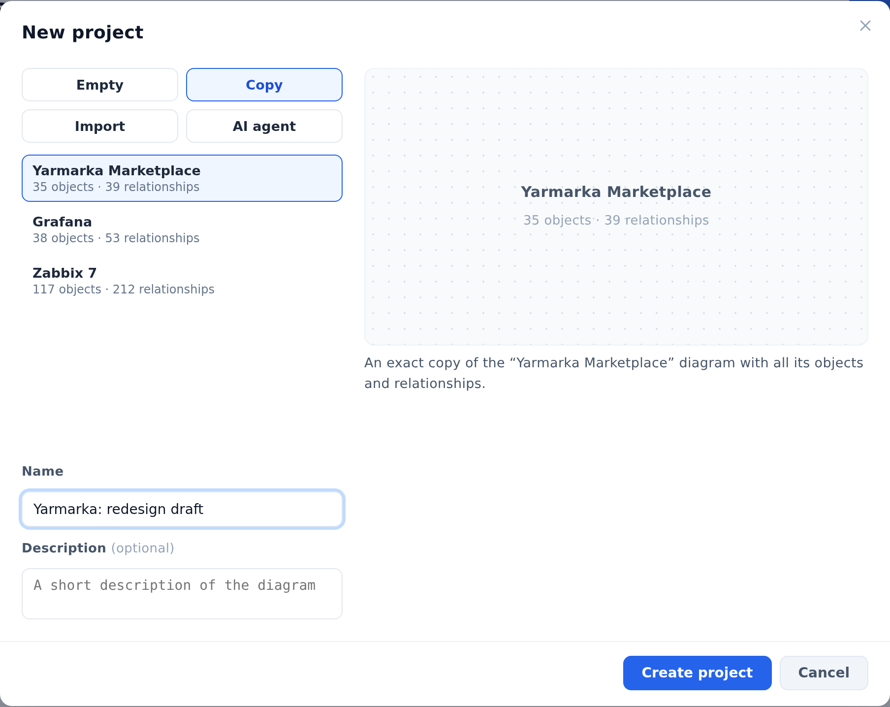

::: note
To create projects, you need the **Architect** account role, which an administrator grants. The creator becomes the project owner. Until the owner shares the project (see [Share a project and assign roles](access.md)), only they can see it.
:::

::: note
You can also create a project from existing files. The **Import** option creates a project from YAML files and export archives (see [Export and import a project](export-import.md)). The **AI agent** option creates a project from the system's source code: an AI agent analyzes the repository and returns a YAML file (see [Import a diagram an agent built from code](import-agent.md)).
:::

## Create an empty project

To create an empty project, follow these steps:

1. On the **Projects** screen, click **New project**. The **New project** window opens.
2. Select **Empty**.
3. Enter the project name in the **Name** field.
4. If needed, briefly describe the system in the **Description** field.
5. Click **Create project**. The new project's page opens.

::: note
You can also create a project from the header of any project. To do this, click the project name and select **New project** at the bottom of the list.
:::

::: note
The description appears on the project card, and the search on the **Projects** screen looks through it.
:::

::: note
You fill an empty project in the diagram editor. To open the editor, click **Start building** in the **System diagram** section of the project page (see [Add objects and containers](nodes.md)).
:::

## Copy a project

To copy a project, follow these steps:

1. On the **Projects** screen, click **New project**.
2. In the **New project** window, select **Copy**. A list of projects appears.
3. Select the project you want to copy.
4. Enter a name for the copy in the **Name** field.
5. Click **Create project**. The copy's page opens.

::: note
The copy includes everything in the project: objects, relationships, object positions on the diagrams, logic diagrams, specifications, database structures, broker channels, configuration parameters, and business processes. Members aren't copied: you're the owner of the copy, and no one else can see it.
:::

::: note
The list shows only active projects you have access to, including the ones shared with you as a reader. To copy an archived project, restore it first (see [Archive, restore, or delete a project](archive.md)).
:::

## Rename a project or change its description

To change a project's name or description, follow these steps:

1. On the **Projects** screen, click **⋯** on the project card.
2. Select **Edit**. The **Edit project** window opens.
3. Change the name or description and click **Save**.

::: note
Only the project owner sees the **Edit** item.
:::
