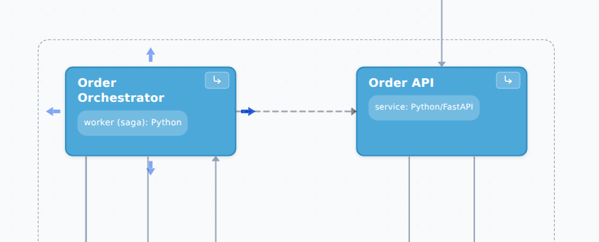

::: note
A relationship points from the object that makes the call to the object being called (for example, from a service to its database). You add relationships in the diagram editor (see [Open the diagram editor](nodes.md#editor)).
:::

## Add a relationship on the diagram

To add a relationship, follow these steps:

1. In the diagram editor, hover over the object the relationship starts from. Arrows appear on the sides of the object.
2. Draw the relationship in one of the following ways:
    - drag any arrow and drop it on the target object;
    - hover over an arrow and, if the dashed line from it leads to the right object, click the arrow.

    The **New relationship** window opens.
3. In the **Description** field, briefly describe what the call is for (for example, “Order checkout”).
4. In the **Technology** field, enter the protocol or technology (for example, REST or Kafka).
5. Click **Create relationship**. The relationship appears on the diagram.

::: note
It doesn't matter which side's arrow you drag, because ArchMap routes the line itself.
:::

::: note
If you drop the arrow on an empty area of the diagram, no relationship is created.
:::

## Connect an object to a container's component {#component}

To connect an object to a component of a container, follow these steps:

1. In the diagram editor, drag an arrow from the object and drop it on the container. The **Relationship into “…”** window opens with a list of the container's components.
2. Select the component the relationship leads to.
3. Fill in **Description** and **Technology**.
4. Click **Create relationship**.

::: note
You can't connect an object directly to a container on the diagram, so ArchMap always asks you to choose a component. If a relationship was drawn to an object that later became a container, you can move its end to a child component (see [Edit or delete a relationship](#edit)).
:::

## Connect an object to an object on another level

To connect an object to an object that isn't on the current level, follow these steps:

1. In the diagram editor, drag an arrow from the object. The **Object outside the level** strip appears at the top of the diagram.
2. Drop the arrow on the strip. The **Relationship to an object outside the level** window opens.
3. Find and select the target object.
4. Fill in **Description** and **Technology**.
5. Click **Create relationship**.

::: note
The root level has no **Object outside the level** strip, because all other objects in the project are inside containers on this level. To connect to one of them, drop the arrow on its container (see [Connect an object to a container's component](#component)).
:::

## Edit or delete a relationship {#edit}

To edit or delete a relationship in the diagram editor, follow these steps:

1. Double-click the relationship's line or label. The relationship panel opens on the right.
2. If several relationships share the line, the **Select a relationship** window opens. Click the relationship you need.
3. Change the fields you need. Changes are saved when you move to another field.
4. To delete the relationship, click **Delete relationship**.

::: note
If the relationship leads to or from a broker, enter the topic or queue in the **Channel** field. If the broker's **Channels** section has no such channel, a warning appears under the field (see [Document broker channels](channels.md)).
:::

::: note
You can undo editing or deleting a relationship in the editor with <kbd>Ctrl</kbd>+<kbd>Z</kbd> (see [Undo an action](nodes.md#undo)).
:::

To edit or delete a relationship on an object page, follow these steps:

1. In the **Relationships** section of the object page, click the relationship row. The **Edit relationship** window opens.
2. Change the fields you need. **Reverse direction** swaps the ends of the relationship.
3. Click **Done**.
4. To delete the relationship, click **Delete** and confirm the deletion.

::: note
Changes made on an object page can't be undone.
:::
