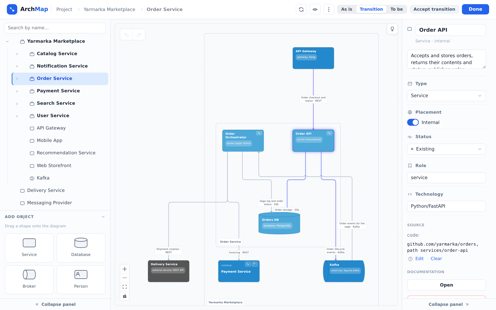

::: note
You add objects and relationships in the diagram editor. The editor shows one level of the diagram: the project root or the contents of a single container. In ArchMap, a container is a service that has child components.
:::

## Open the diagram editor {#editor}

To open the diagram editor, click **Edit** above the diagram in one of the following places:

- in the **System diagram** section of the project page. The editor opens at the root level;
- in the **Diagram** section of an object page. The editor opens at the level that contains the object and highlights it.

::: note
An empty project has no **Edit** button. Click **Start building** in the **System diagram** section instead.
:::

::: note
**Done** in the upper-right corner closes the editor and returns you to the page you opened it from.
:::

## Add an object {#add}

To add an object, follow these steps:

1. In the diagram editor, go to the level where you want to add the object. To do this, click the container in the tree on the left. The **Project** link in the path at the top of the page leads to the root level.
2. Drag the shape of the new object from the **Add object** section on the left onto the diagram. The **New object** window opens.
3. Enter the object's name in the **Name** field.
4. If needed, fill in **Description**, **Role**, and **Technology**.
5. If the object isn't part of your system (for example, it's a neighboring system or a third-party provider), select **External**.
6. Click **Create**. The object appears on the diagram where you dropped the shape.

::: note
The role and technology appear under the object's name on the diagram (for example, “service: Python/FastAPI”). Both are free text, so follow your team's conventions.
:::

::: note
The **Status** field is for planned changes. **Planned** marks a new object, and **Deprecated** marks an object that will be removed (see [Plan changes to the system](changes.md)).
:::

## Add a component to a service

To add a component to a service, follow these steps:

1. In the diagram editor, open the **New object** window in one of the following ways:
    - in the tree on the left, hover over the service and click **+** to the right of its name;
    - if the service already has components, click the service in the tree on the left and drag a shape from the **Add object** section onto the diagram;
    - on the diagram, click **Enter** in the upper-right corner of the service. The service's level opens with its frame, which is empty if the service has no components yet. Drag a shape from the **Add object** section into the frame.
2. Fill in the fields and click **Create**. The component appears in the tree under the service. If the service had no components before, it becomes a container.

::: note
The **+** button creates a component with the **Service** shape. You can change the shape in the properties panel (see [Edit object properties](#props)).
:::

::: note
Only services can have components. Databases, brokers, and persons can't become containers.
:::

::: note
A container doesn't have its own logic diagrams or specifications. If a service already had logic diagrams, they still belong to it after it gets components, but its page shows a **Distribute to components** button. Use it to move the documentation to the child components.
:::

## Edit object properties {#props}

To edit an object's properties, follow these steps:

1. In the diagram editor, double-click the object. Its properties panel opens on the right.
2. Change the fields you need. Changes are saved when you move to another field.

::: note
You can edit the same properties in the **Properties** section of the object page.
:::

::: note
A container's technology is collected from its components' technologies, so you can't edit it manually.
:::

## Move an object to another container {#move}

To move an object, follow these steps:

1. In the diagram editor, hover over the object in the tree on the left. A drag handle appears to the left of its name.
2. Drag the object by the handle onto the row of the service you want to move it to. To move the object to the root level, drag it onto the **To project root** strip. The strip appears at the top of the tree when you start dragging.

::: note
The object moves together with its components, relationships, and documentation. A person can be moved only to the root level.
:::

## Delete an object

To delete an object, follow these steps:

1. In the diagram editor, click the object to select it.
2. Press <kbd>Delete</kbd>.
3. If the object has relationships, components, or documentation, a window opens listing everything that will be deleted along with it. Click **Yes, delete**.

::: note
You can also delete an object with **Delete object** in the properties panel.
:::

::: note
To delete several objects, select them in one of the following ways:

- drag a selection frame over them, starting from an empty area of the diagram;
- click the objects while holding <kbd>Ctrl</kbd>.
:::

::: note
You can also delete an object on its page. To do this, select **Delete object** in the **⋯** menu next to the title. This deletion can't be undone.
:::

## Undo an action {#undo}

To undo the last action in the diagram editor, do one of the following:

- press <kbd>Ctrl</kbd>+<kbd>Z</kbd>;
- click **Undo** in the upper-left corner of the diagram.

::: note
To redo an undone action, press <kbd>Ctrl</kbd>+<kbd>Shift</kbd>+<kbd>Z</kbd> or click **Redo** next to **Undo**.
:::

::: note
Undo restores a deleted object completely, with its components, relationships, and documentation. You can undo actions while the editor is open. When you click **Done**, the history is cleared.
:::
