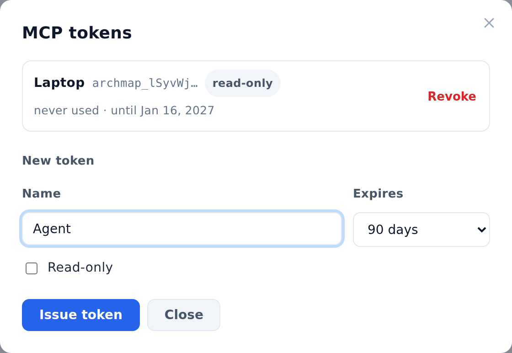
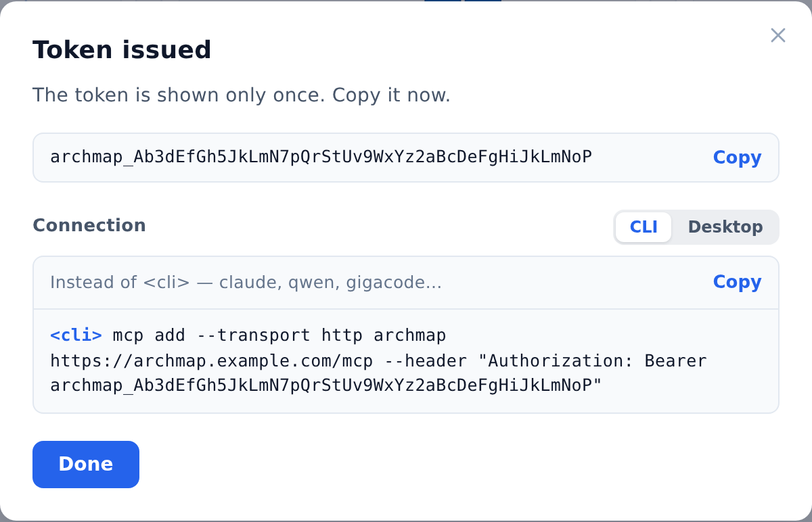

::: note
An AI agent that supports MCP (for example, Claude Code or Qwen Code) connects to ArchMap with a URL and a personal token. There's nothing to install: ArchMap itself is an MCP server, available at the address you open in your browser followed by `/mcp` (for example, `https://archmap.example.com/mcp`). The agent acts on behalf of your account.
:::

## Issue a token

To issue a token, follow these steps:

1. Click your profile icon in the upper-right corner of any page. The profile menu opens.
2. Select **MCP tokens**. The **MCP tokens** window opens with a list of your tokens.
3. In the **Name** field, enter what the token is for (for example, the name of the agent or computer).
4. In the **Expires** list, select how long the token is valid: 30 days, 90 days, 1 year, or no expiry.
5. If the agent only needs to read the documentation, select **Read-only**.
6. Click **Issue token**. The **Token issued** window opens with the token and a connection string.

::: note
If your ArchMap role is Viewer (it's shown at the top of the profile menu), all your tokens are read-only: **Read-only** is selected and can't be cleared.
:::

## Connect the agent

To connect the agent, follow these steps:

1. In the **Token issued** window, under **Connection**, select the tab for your type of agent:
    - **CLI**, if the agent runs in a terminal and adds MCP servers with an `mcp add` command;
    - **Desktop**, if the agent keeps MCP servers in a settings file (for example, `mcp.json`).
2. Click **Copy** above the connection string on the right.
3. Add the `archmap` server to the agent:
    - on the **CLI** tab, replace `<cli>` in the command with the agent's program name (for example, `claude` or `qwen`) and run the command in a terminal;
    - on the **Desktop** tab, paste the block into the agent's MCP settings file.
4. In the **Token issued** window, click **Done**.
5. Check the connection. To do this, restart the agent and ask it to list your ArchMap projects. It replies with the projects available to your account and your role in each.

::: note
Settings file formats differ between agents. For example, in VS Code the server block is called `servers`, not `mcpServers`. If the agent doesn't see the `archmap` server, check the agent's documentation on connecting a remote MCP server with an `Authorization` header.
:::

::: note
The token is shown only once, so copy it or the connection string while the window is open. After that, the token list shows only the beginning of the token.
:::

::: note
A token gives access to ArchMap just like a password. Don't keep it in files that go into git. If the agent's settings file is in a repository, take the token from an environment variable instead (see the agent's documentation for how to do this).
:::

::: note
The agent has the same access to ArchMap as you do, and it can make changes only where you're an owner or editor. It can't delete anything, and with a read-only token it can't change anything either: ArchMap rejects any edit. The agent also can't manage projects or their members, issue tokens, or change passwords.
:::

::: note
If ArchMap uses HTTPS with a certificate issued by an internal certificate authority, the agent must trust that authority. For agents built on Node.js (for example, Claude Code and Qwen Code), set the `NODE_EXTRA_CA_CERTS` environment variable to the root certificate file. Editors based on VS Code usually only need the authority's certificate installed in the operating system. If you connect through a proxy, add the ArchMap address to the `NO_PROXY` variable.
:::

::: note
You can't connect an agent to the demo site.
:::

## Revoke a token

To revoke a token, follow these steps:

1. In the profile menu, select **MCP tokens**. The window lists your tokens, showing when each was last used and when it expires.
2. Click **Revoke** next to the token. The **Revoke token “…”?** question appears.
3. Click **Revoke**. The agent using this token loses access to ArchMap immediately.

::: note
If the agent reports error 401, the token has been revoked, has expired, or was copied incorrectly. Issue a new token and replace it in the agent's settings. Error 429 means the agent sent too many requests. Wait a minute and try again.
:::
