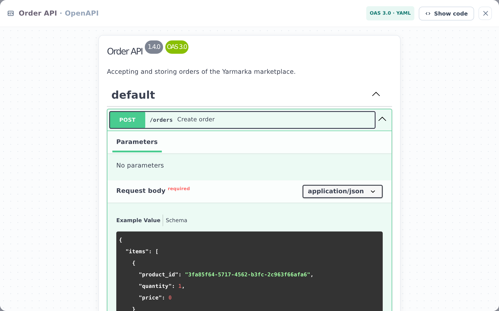

::: note
An OpenAPI specification describes a service's HTTP API: its endpoints, their parameters, request bodies, and responses.
:::

## Open the specification

To view a service's API, follow these steps:

1. Open the service page (see [Find service documentation](find-service.md)) and scroll down to the **OpenAPI** section.
2. Click **Specification**. A window with a list of endpoints opens.
3. Click an endpoint to expand its parameters, request body, and responses.
4. To close the window, click × in the upper-right corner or press <kbd>Esc</kbd>.

::: note
If a service page has no **OpenAPI** section, the service has no documented specification.
:::

::: note
The window is read-only: you can't send requests to the service from it.
:::

::: note
Click **Show code** in the window header to see the specification source. You can copy the text, but you can't edit it.
:::

::: note
For a container service, the **OpenAPI** section combines the specifications of its components. Click the left part of a row to open a specification, or **from …** on the right to go to the component that owns it.
:::

## View the logic behind an endpoint

To view the logic behind an endpoint, follow these steps:

1. In the specification window, find the endpoint and note its method and path (for example, **POST /orders**).
2. Close the window.
3. In the **Logic** section of the service page, find the diagram with this endpoint in the **Operations** list and click it. The diagram opens in a window (see [View operation and worker logic](logic.md)).

::: note
If no diagram in the **Operations** list shows this endpoint, its logic hasn't been documented.
:::
