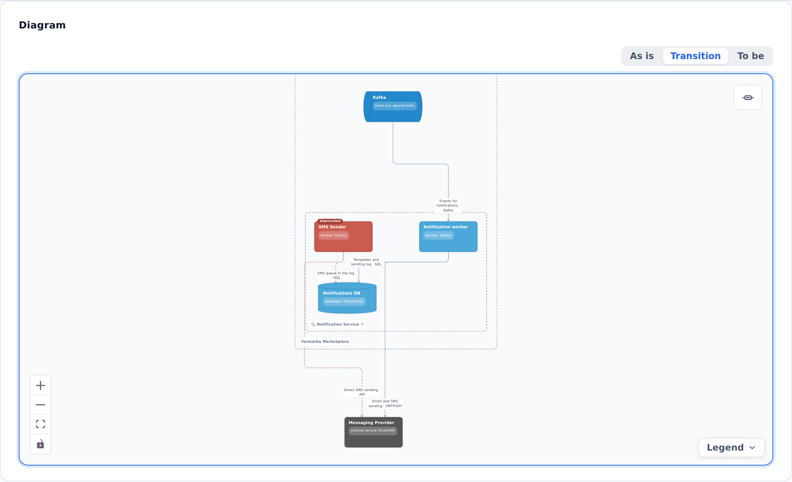

::: note
Architects assign each object a status: **Existing**, **Planned** (to be added), or **Deprecated** (to be retired). Based on these statuses, the diagram can show the system as it is today, as it will be after the changes, and the transition between the two.
:::

## Check an object's status

To check whether an object is affected by planned changes, follow these steps:

1. On the diagram, look for objects with a label above their name:
    - a green object labeled **new** is planned;
    - a red object labeled **deprecated** is being retired.
2. Open the object page. The **Status** row in the **Properties** section shows the object's status.

::: note
Relationships of planned objects are shown in green, and those of deprecated objects in red.
:::

## Switch the diagram view

To see the system before or after the changes, follow these steps:

1. Above the diagram on a project, object, or process page, select a view:
    - **As is**: what's running today, including deprecated objects;
    - **Transition** (default): all objects;
    - **To be**: the target state, without deprecated objects.
2. Review the diagram. Objects that aren't part of the selected view stay in place but are dimmed.

::: note
The view switch appears only if the project has planned or deprecated objects.
:::

::: note
In business processes, steps whose participants aren't part of the selected view are dimmed as well.
:::

::: note
ArchMap remembers the selected view for each project in your browser.
:::
