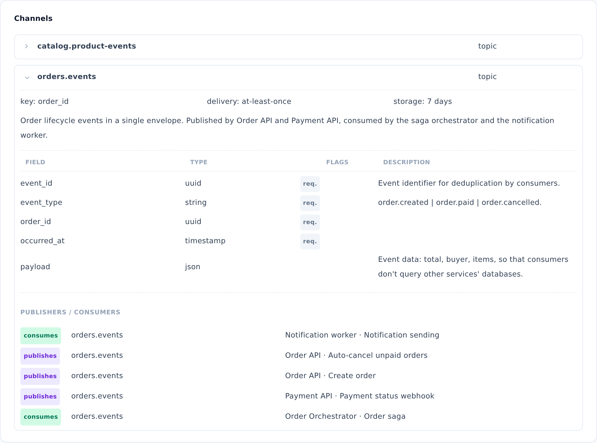

::: note
Message broker channels are linked to logic diagrams by the “publishes” and “consumes” markers in diagram steps (see [View operation and worker logic](logic.md)). Using these markers, the **Channels** section shows which services and diagrams publish to and consume from each channel.
:::

## View a channel

To view a message broker's channels, follow these steps:

1. Open the broker page (see [Find service documentation](find-service.md)) and scroll down to the **Channels** section.
2. Click the arrow next to a channel name to expand it. The delivery settings, message fields, and the **Publishers / consumers** list appear.
3. In the **Publishers / consumers** list, see which services and logic diagrams publish to the channel or consume from it.

::: note
In ArchMap, a channel is whatever your broker calls it: a topic in Kafka, a queue or exchange in RabbitMQ, a stream in Redis, or a subject in NATS. The channel type is shown to the right of its name.
:::

::: note
Rows in the **Publishers / consumers** list don't link to logic diagrams. To open a diagram, use the **Logic** section on the service page (see [View operation and worker logic](logic.md)).
:::

::: note
**No channels documented** means that the broker's channels haven't been documented in the project yet.
:::
