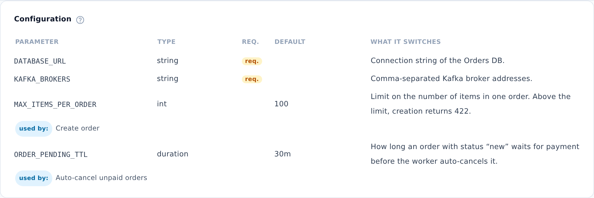

::: note
A service's configuration parameters are linked to its logic diagrams by the “depends on” markers in diagram steps (see [View operation and worker logic](logic.md)). Using these markers, the **Configuration** section shows which diagrams have steps that depend on each parameter.
:::

## View a parameter

To view a service's configuration, follow these steps:

1. Open the service page (see [Find service documentation](find-service.md)) and scroll down to the **Configuration** section.
2. Find the parameter you need.
3. Check the **used by:** line below the parameter. It lists the service's logic diagrams whose steps depend on the parameter.

::: note
The **Default** column shows the default value from the service's code. ArchMap doesn't store values for specific environments, such as test or production.
:::

::: note
The **used by:** line appears only for parameters referenced by “depends on” markers in the same service's logic diagrams. The diagram names in this line aren't links. To open a diagram, use the **Logic** section on the same page (see [View operation and worker logic](logic.md)).
:::

::: note
**No parameters documented** means that the service's configuration hasn't been documented in the project yet.
:::
