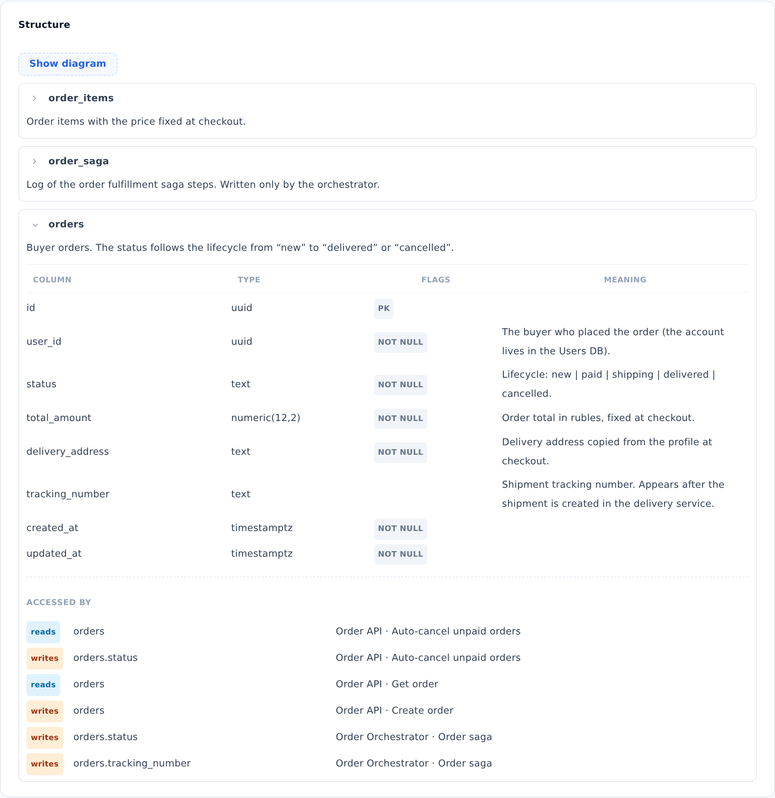

::: note
Database tables are linked to logic diagrams through the “reads” and “writes” markers in diagram steps (see [View the logic of an operation or worker](logic.md)). Based on these markers, the **Structure** section shows which services and diagrams access a table.
:::

## View a table

To view a database structure, follow these steps:

1. Open the database page (see [Find a service's documentation](find-service.md)) and scroll to the **Structure** section.
2. In the **Structure** section, expand a table. To do this, click the arrow to the left of its name. The table's columns and the **Accessed by** list appear.
3. In the **Accessed by** list, find the row with the table or column you need. The row shows the service and its logic diagram that read or write the table.

::: note
The **Show diagram** button shows the relationships between tables as an ER diagram. Click the diagram, and it opens in full screen.
:::

::: note
The rows of the **Accessed by** list do not open logic diagrams. A diagram opens on the service page in the **Logic** section (see [View the logic of an operation or worker](logic.md)).
:::

::: note
If the section says **No tables documented**, the database structure has not been documented in the project yet.
:::
