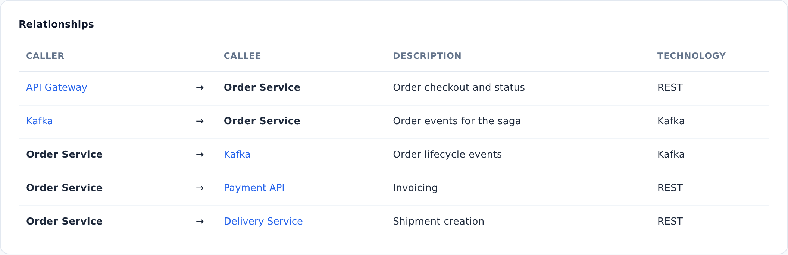

::: note
A relationship in ArchMap is directed: from the calling object to the called one. A relationship has a description and a technology; on the diagram, they form the arrow's label, separated by a dot (for example, “Order checkout and status · REST”).
:::

## View relationships in a table

To view a service's relationships in a table, follow these steps:

1. Open the service page (see [Find a service's documentation](find-service.md)).
2. Scroll the page to the **Relationships** section. Each row of the table describes one relationship: the caller, the callee, the description, and the technology.
3. In a row, click the name of the other object. Its page opens.

::: note
The table shows only external relationships: those of the service and its components with objects outside. To see the relationships between the components inside the service, expand the service on the diagram with the magnifier (see [Navigate diagram levels](levels.md)) or open the components' pages.
:::

::: note
The table does not show the kind of relationship (a call with a reply or a message through a broker): rely on the technology and on whether the relationship goes to a message broker.
:::

## View relationships on the diagram

To see a service's relationships on the diagram, follow these steps:

1. On the service page, in the **Diagram** section, activate the diagram. To do this, click it.
2. On the diagram, click the service. All its relationships are highlighted.
3. Double-click an arrow. The relationship is highlighted along its whole length, including the segments it shares with other arrows.
4. If several relationships run along one line, the **Select a relationship** window opens. Click a relationship in the list.
5. Double-click the object at the other end of the relationship. Its page opens.

::: note
Objects from other levels are shown on the diagram with a dashed frame. Their pages open the same way, with a double-click.
:::

::: note
If the arrow labels make the diagram hard to read, hide them with the button in the upper-right corner of the diagram; the same button shows the labels again.
:::
