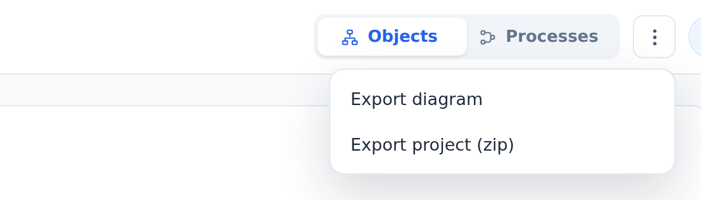

::: note
Export lets you download a project's knowledge, for example, to give the diagram to an AI agent or to keep a copy. Anyone with access to the project can export it, including readers.
:::

## Export the diagram as YAML

To export the diagram as YAML, follow these steps:

1. Open the page you want to export:
    - the project page, to export the diagram of the whole project;
    - an object page, to export the object with all of its components.
2. Click **Diagram actions** (the three dots) in the upper-right corner. A menu opens.
3. Select **Export diagram** (on an object page, **Export subtree**). A window with the YAML opens.
4. Click **Copy**. The YAML is copied to the clipboard.

::: note
The YAML includes the objects (name, type, role, technology, description, and source) and the relationships between them. Logic diagrams, specifications, database structures, channels, configuration, and processes are only in the project archive.
:::

## Download the project archive

To download the project archive, follow these steps:

1. Open the project page.
2. Click **Diagram actions** in the upper-right corner.
3. Select **Export project (zip)**. Your browser downloads the archive.

::: note
The archive contains everything in the project: the diagram, logic diagrams, OpenAPI specifications, database structures, broker channels, configuration, and business processes. **Export project (zip)** is available only on the project page.
:::

::: note
An architect can restore the project from the archive in ArchMap.
:::

## Export a business process to Mermaid

To export a business process, follow these steps:

1. Open the process (see [View a business process](processes.md)).
2. Click **Diagram actions** in the upper-right corner.
3. Select **Export process “…” (Mermaid)**. A window opens with the diagram in Mermaid syntax.
4. Click **Copy**.
