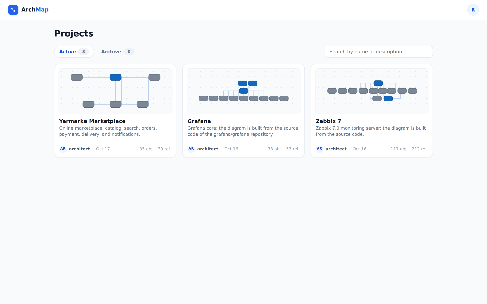
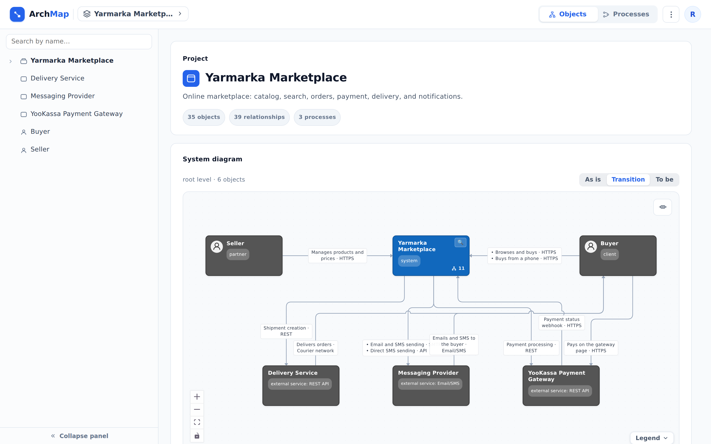

::: note
In ArchMap, each project describes a single system: its objects, the relationships between them, their documentation, and business processes. A project is visible to its members and, if the owner has made it visible to all users, to everyone who signs in to ArchMap. Projects you don't have access to don't appear in the list and can't be opened by a direct link. The project owner manages members.
:::

## Find a project

To find a project, follow these steps:

1. Sign in to ArchMap. The **Projects** screen opens, listing the projects you have access to.
2. If the list is long, type part of the project name or description in the **Search by name or description** field. The list is filtered as you type.
3. Click the project card. The project page opens.

::: note
Archived projects (on the **Archive** tab) can't be opened until the owner restores them.
:::

::: note
If you followed a link to a page inside a project, that page opens after you sign in. To return to the project list, click the **ArchMap** logo in the upper-left corner.
:::

To switch to another project without going back to the list, follow these steps:

1. In the header, click the project name. A list of projects opens.
2. Select a project in one of the following ways:
    - click the project in the list;
    - start typing its name in the **Search projects** field and click the project in the results.

## Explore the system

To explore the system, follow these steps:

1. Open the project page. The **System diagram** section shows the root level: the top-level systems and how they are connected.
2. Click the diagram to make it interactive.
3. Zoom and pan the diagram in one of the following ways:
    - scroll the mouse wheel to zoom;
    - drag an empty area to pan;
    - use the zoom buttons in the lower-left corner of the diagram.
4. Click an object. The object is selected, and all of its relationships are highlighted.
5. On a container, click the **Expand contents** magnifier. The container's components appear inside its frame, and the relationships now connect to them. To hide the components again, click **Collapse** in the corner of the frame.
6. Double-click an arrow. The relationship is highlighted from end to end. If several relationships share the same line, ArchMap asks you to choose one.
7. When you're done, press <kbd>Esc</kbd> or click outside the diagram. The diagram becomes static again.

::: note
Click **Legend** in the lower-right corner of the diagram to see what object shapes, status colors, and frames mean. The button in the upper-right corner shows or hides relationship labels.
:::

::: note
If the project includes planned changes, an **As is** / **Transition** / **To be** switch appears above the diagram (see [View planned changes](changes.md)).
:::

::: note
If other members are editing the project at the same time, the diagram updates automatically, and **Diagram updated in another session** appears above it for a few seconds.
:::

To view the system's business processes, follow these steps:

1. On the project page, scroll down to the **Business processes** section.
2. Click a process. The project switches to **Processes** mode and opens the process (see [View a business process](processes.md)).

::: note
The **Business processes** section appears only if the project has documented processes.
:::

## Go to the first level

To go from the root diagram to an object's level, open the object page in one of the following ways:

- double-click the object on the diagram;
- click the object in the tree on the left.

::: note
To learn how to move further between levels, see [Navigate between diagram levels](levels.md). To jump straight to a specific service without drilling down level by level, search for it by name (see [Find service documentation](find-service.md)).
:::
