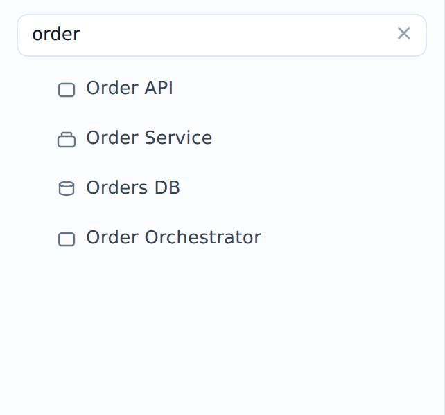

::: note
A service's documentation is collected on its page: properties, diagram, relationships, operation logic, API, facts from code, and participation in business processes. In the interface, you can search for an object by name. Searching the contents of the documentation (logic diagram text, tables, channels, and parameters) is available only to an AI agent through the MCP server (see [Ask an AI agent about the system](agent-ask.md)).
:::

## Find a service by name

To find a service by name, follow these steps:

1. Open the project.
2. In the **Search by name…** field above the object tree, type part of the name. A list of objects whose names contain the text appears below the field.
3. Click the object in the list. Its page opens.

::: note
The list of results does not show where an object is in the tree: the path from the project root is shown at the top of its page.
:::

::: note
If you don't know the name, go down to the service level by level from the project page (see [Navigate diagram levels](levels.md)).
:::

## Find the right section on a service page

To find the documentation you need on a service page, scroll the page to the section that answers your question:

- whom the service exchanges data with and how: the **Relationships** section (see [View a service's relationships](edges.md));
- how an operation or worker works: the **Logic** section (see [View the logic of an operation or worker](logic.md));
- which operations the service's API has: the **OpenAPI** section (see [View a service's API](api.md));
- which parameters the service reads: the **Configuration** section (see [View a service's configuration](config.md));
- which business processes the service participates in: the **Participates in processes** section (see [View a business process](processes.md));
- where the service's code is: the **Source** field in the **Properties** section (see [Find the repository and code path of a service](source.md)).

::: note
The set of sections depends on the object type. A service has **Logic**, **OpenAPI**, and **Configuration**; a database has a **Structure** section with tables instead (see [View a database structure](db.md)); a message broker has a **Channels** section (see [View broker channels](channels.md)); a person has only **Properties**, **Diagram**, **Relationships**, and **Participates in processes**. The **Logic**, **OpenAPI**, and **Participates in processes** sections are hidden if nothing is documented in them; the fact sections stay, labeled “not documented”.
:::

::: note
For a container service, the **Logic** and **OpenAPI** sections collect the documentation of its components, grouped by component.
:::
