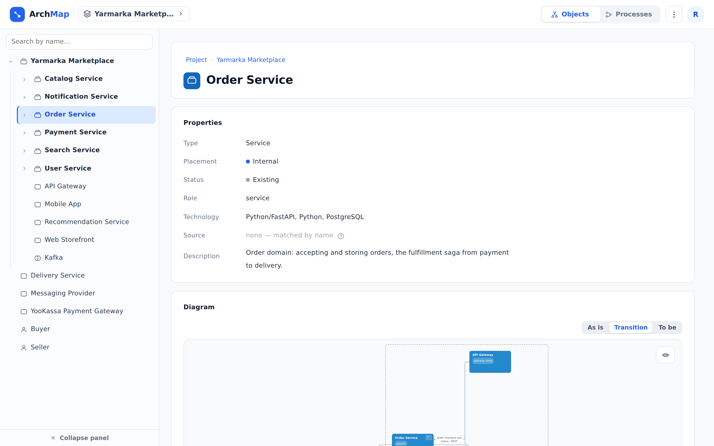
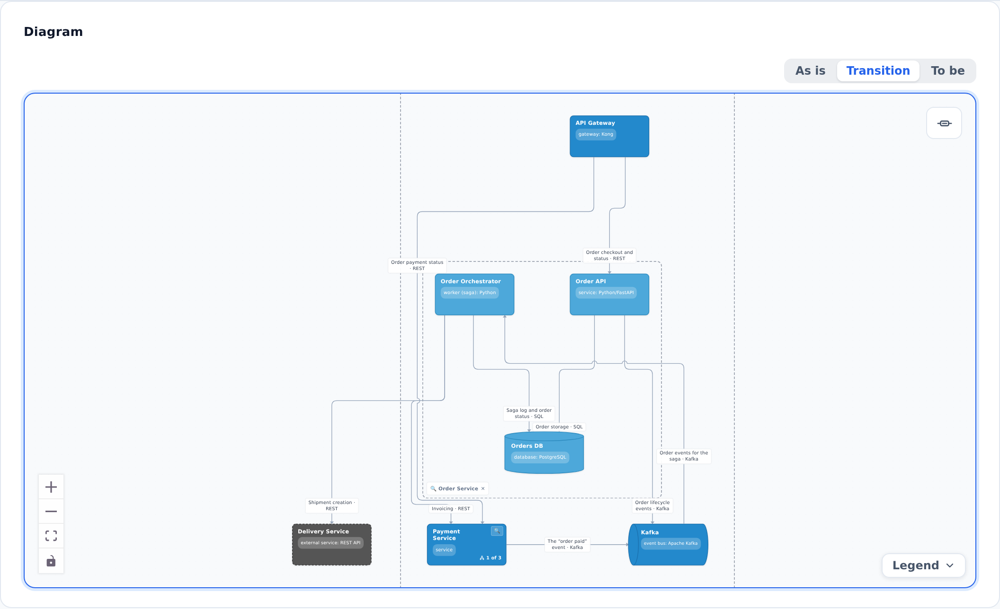

::: note
A project in ArchMap is organized as a tree of objects. An object that has components is called a container. Only a service can be a container; databases, brokers, and persons have no components. A level consists of the components of one container and the relationships between them. The root level is shown on the project page; the other levels open from object pages.
:::

## Open an object page

To open an object page, do one of the following:

- on the diagram of the project page or another object page, double-click the object;
- click the object in the tree on the left;
- in the **Search by name…** field above the tree, type part of the name and click the object found.

::: note
The diagram on an object page shows:
- the object itself;
- neighbors from the same level that it is related to (with a solid frame);
- neighbors from other levels (with a dashed frame);
- the relationships between all of them, including relationships between the neighbors;
- the dashed frame of the parent container.

Objects from the same level that the object is not related to do not appear on its diagram: you can see them on the parent's diagram.
:::

::: note
Below the diagram, the object page has the **Relationships**, **Logic**, **OpenAPI**, and **Participates in processes** sections (see [View a service's relationships](edges.md), [View the logic of an operation or worker](logic.md), [View a service's API](api.md), [View a business process](processes.md)).
:::

## Go down a level

To view a container's components without leaving the diagram, follow these steps:

1. On the diagram, find a container: it has the **Expand contents** magnifier.
2. Click the magnifier. The container's components appear inside its frame, and the arrows extend to them.
3. Go deeper. To do this, click the magnifier on any component that is a container.
4. Hide the components. To do this, click **Collapse** in the corner of the frame.

::: note
You can expand a container this way both on the project page and on any object page.
:::

::: note
You can expand only two levels in a row: deeper, the magnifier becomes inactive and suggests going to the component's page.
:::

To go to a component's level, follow these steps:

1. Expand the container with the **Expand contents** magnifier.
2. Double-click the component. Its page opens with the diagram of its level.

## Go up a level

To go up a level, do one of the following:

- at the top of the object page, in the **Project › …** path, click the name of the ancestor;
- return to the project page and the root level. To do this, click **Project** at the beginning of the same path;
- click the ancestor in the tree on the left.

## Use the object tree

To find an object in the tree on the left, follow these steps:

1. Click the arrow to the left of a container's name. The branch expands.
2. Click the name of the object. Its page opens.

::: note
The tree expands by itself down to the object whose page is open. The **Collapse panel** button at the bottom hides the tree, and **Expand panel** brings it back.
:::

::: note
The **Search by name…** field above the tree searches object names only. Searching the whole project documentation is described in [Find a service's documentation](find-service.md).
:::
