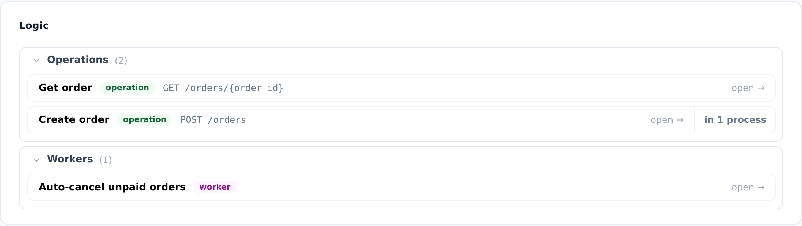
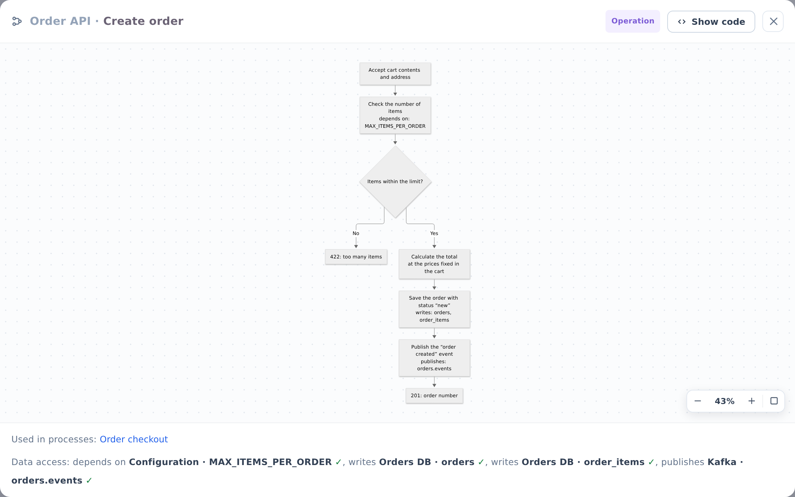

::: note
A logic diagram describes one service operation (a request handler or a scenario) or one worker (a background job) step by step: what it receives, what it checks, where it writes data, and what it returns. An operation's diagram can be linked to an endpoint in the service's OpenAPI specification.
:::

## Open a logic diagram

To view the logic of an operation or worker, follow these steps:

1. Open the service page (see [Find service documentation](find-service.md)) and scroll down to the **Logic** section. Diagrams are grouped into **Operations** and **Workers**, and each operation shows the endpoint it handles.
2. Click a diagram. It opens in a window.

::: note
If a service has many diagrams, you can collapse and expand the **Operations** and **Workers** lists with the arrow next to each heading.
:::

::: note
The **in N processes** button next to a diagram shows which business process steps the diagram documents. Click the button, and then click a process in the list to open it (see [View a business process](processes.md)).
:::

## Read the diagram

To read a logic diagram, follow these steps:

1. Follow the steps from top to bottom along the arrows. Diamonds are decisions with **Yes** and **No** branches.
2. To zoom, use the mouse wheel or the buttons in the lower-right corner of the window: zoom out, zoom in, and fit to window. To pan, drag the diagram.
3. Check the **Data access** line below the diagram. It lists the tables, broker channels, and configuration parameters that the steps use. The same markers (“reads”, “writes”, “publishes”, “consumes”, and “depends on”) also appear in the steps themselves (see [View database structure](db.md), [View broker channels](channels.md), [View service configuration](config.md)).
4. To open a business process that includes this operation as a step, click its name in the **Used in processes** line.
5. To close the window, click × in the upper-right corner or press <kbd>Esc</kbd>.

::: note
Click **Show code** in the window header to see the diagram's Mermaid source. You can copy the text, but you can't edit it.
:::

::: note
A check mark after an item means that the table, channel, or parameter is documented in the project. A warning sign followed by an explanation means that no match was found.
:::

::: note
The **Not documented** block at the bottom of the **Logic** section lists operations and workers that the AI agent found in the code but hasn't documented yet. You can open them, but they don't have a diagram yet.
:::

::: note
For a container service, the **Logic** section combines the diagrams of its components, grouped by component. Click the left part of a row to open the diagram, or **from …** on the right to go to the component that owns it.
:::
