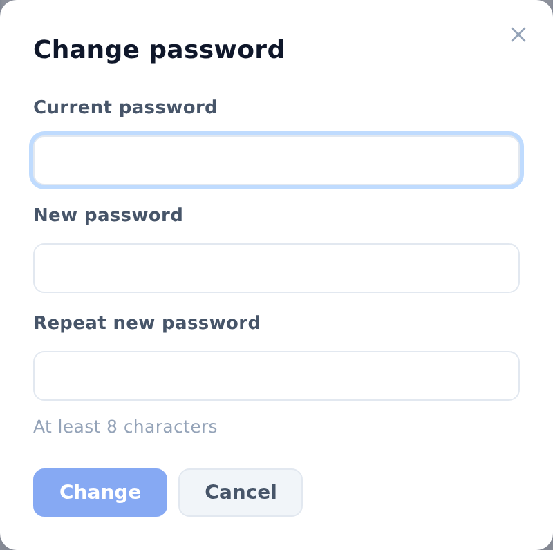

## Change your password

To change your password, follow these steps:

1. Click your profile icon in the upper-right corner of any page. The profile menu opens.
2. Select **Change password**. The **Change password** window opens.
3. Enter your current password in the **Current password** field.
4. Enter a new password in the **New password** and **Repeat new password** fields. It must be at least 8 characters long.
5. Click **Change**. The **Password changed** message appears.
6. Click **Done**.

::: note
You stay signed in. You'll need the new password the next time you sign in.
:::

::: note
If you've forgotten your password, ask your ArchMap administrator to set a new one.
:::

::: note
Guests on the demo site don't have a profile menu and can't change the password.
:::
