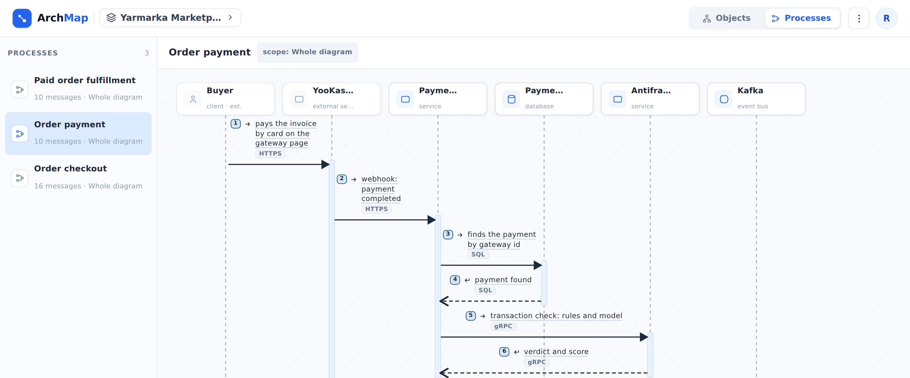

::: note
A business process shows step by step how services interact in a single scenario, such as paying for an order: who calls whom, how they respond, and which events they publish. Processes are drawn as sequence diagrams, with participants across the top and steps running from top to bottom.
:::

## Open a process

To open a business process, follow these steps:

1. Open the project (see [Find a project and explore the system](find-project.md)).
2. Click **Processes** in the upper-right corner. The project's processes are listed on the left.
3. Click a process. Its diagram appears on the right.

::: note
You can also open a process from:
- the **Business processes** section on the project page;
- the **Participates in processes** section on a service page;
- the **Used in processes** line in a logic diagram window.

To return to the system diagram, click **Objects** in the upper-right corner.
:::

## Read the diagram

To read a process diagram, follow these steps:

1. Follow the steps in numerical order. The arrow style shows the type of step:
    - a solid line with a filled arrowhead is a call;
    - a dashed line is a response;
    - a solid line with an open arrowhead is an event (for example, a message published to a broker).
2. To see the logic behind a step, click its underlined label. A window opens with the logic diagram of the operation that performs the step (see [View operation and worker logic](logic.md)).
3. To open a participant's page, hover over its name at the top of the diagram and click the arrow that appears.

::: note
Labels without an underline can't be clicked, because no logic diagram is linked to the step.
:::

::: note
A frame with a label in its upper-left corner groups steps that follow a special rule:
- **alt**: only one of the branches runs; each branch shows its condition;
- **opt**: the steps run only if the condition is met;
- **loop**: the steps repeat;
- **par**: the steps run in parallel.
:::

::: note
A step crossed out in red no longer matches the system diagram:
- **relationship removed**: the relationship that the step used no longer exists;
- **no reply expected**: the step is a response, but the relationship is now asynchronous and doesn't expect one.
:::

::: note
The **scope** label next to the process name shows which part of the system the process covers. **Whole diagram** means that it covers the entire project.
:::

::: note
If the process involves planned or deprecated objects, an **As is** / **Transition** / **To be** switch appears above the diagram (see [View planned changes](changes.md)).
:::
