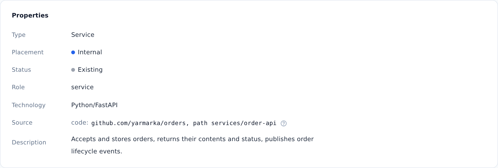

::: note
An object's source shows where its code is: the repository and the path in it. For a dependency whose code is not in the product (a database, a broker, a neighboring product), the source gives the name under which the product refers to it in its settings. ArchMap uses the source to recognize the object when the documentation is updated from code.
:::

## Find the service's code

To find the repository and the path to a service's code, follow these steps:

1. Open the service page (see [Find a service's documentation](find-service.md)).
2. In the **Properties** section, find the **Source** row. It shows one of the following:
    - **code:** the repository and the path to the service's directory in it; if there is no path, the whole repository corresponds to the service;
    - **dependency name:** the name under which the product refers to the object in its settings (for example, in docker-compose); the object's code is not in the product;
    - **none — matched by name:** no source is specified.
3. Copy the repository address and open it in a browser.
4. In the repository, go to the directory shown after the word **path**.

::: note
For objects that the AI agent documented from code, the source is filled in automatically. Objects added by hand may have no source.
:::

::: note
The source describes the product, not its deployment: it contains no server or environment addresses.
:::
