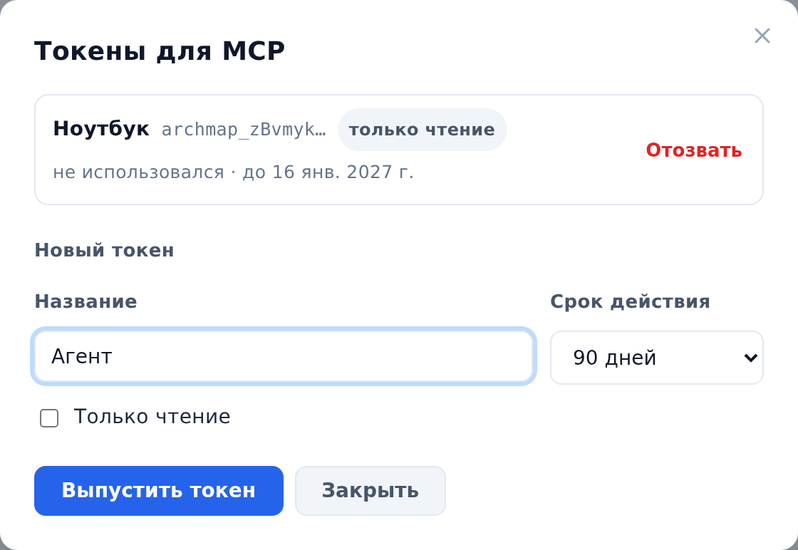
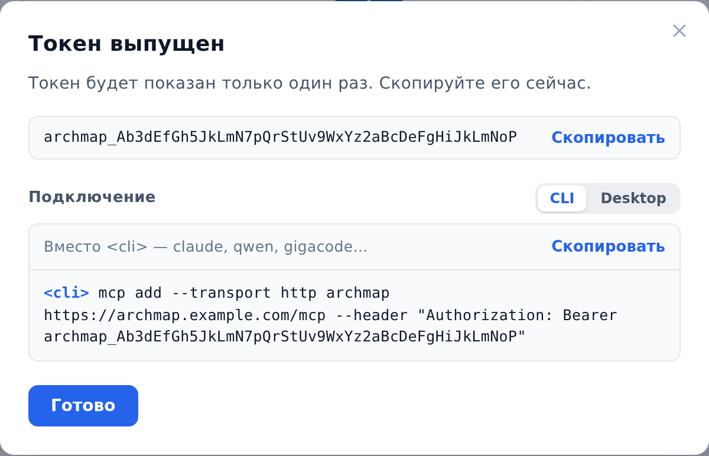

::: note
ИИ-агент с поддержкой MCP (например, Claude Code или Qwen Code) подключается к ArchMap по адресу и личному токену. Устанавливать ничего не нужно: ArchMap сам работает как MCP-сервер по адресу, по которому он открывается в браузере, с добавкой `/mcp` (например, `https://archmap.example.com/mcp`). Агент работает от имени вашей учётной записи.
:::

## Выпустить токен

Чтобы выпустить токен, выполните следующие действия:

1. В правом верхнем углу любой страницы нажмите на кружок профиля. Откроется меню профиля.
2. В меню выберите **Токены для MCP**. Откроется окно **Токены для MCP** со списком ваших токенов.
3. В поле **Название** укажите, для чего токен (например, имя агента или компьютера).
4. В списке **Срок действия** выберите, сколько будет действовать токен: 30 дней, 90 дней, год или бессрочно.
5. Если агенту нужно только читать документацию, установите флажок **Только чтение**.
6. Нажмите кнопку **Выпустить токен**. Откроется окно **Токен выпущен** с токеном и строкой подключения.

::: note
Если ваша роль в ArchMap — «Пользователь» (она указана вверху меню профиля), все ваши токены только для чтения: флажок **Только чтение** установлен, и снять его нельзя.
:::

## Подключить агента

Чтобы подключить агента, выполните следующие действия:

1. В окне **Токен выпущен** в разделе **Подключение** выберите вкладку по типу агента:
    - **CLI**, если агент работает в терминале и добавляет MCP-серверы командой `mcp add`;
    - **Desktop**, если агент хранит MCP-серверы в файле настроек (например, `mcp.json`).
2. Справа над строкой подключения нажмите **Скопировать**.
3. Добавьте сервер `archmap` в агента:
    - на вкладке **CLI** замените в команде `<cli>` именем программы агента (например, `claude` или `qwen`) и выполните команду в терминале;
    - на вкладке **Desktop** вставьте блок в файл настроек MCP-серверов агента.
4. В окне **Токен выпущен** нажмите **Готово**.
5. Проверьте подключение. Для этого перезапустите агента и попросите его показать список проектов ArchMap. Агент ответит списком проектов, доступных вашей учётной записи, и вашей ролью в каждом.

::: note
Формат файла настроек у агентов разный: например, у VS Code блок серверов называется `servers`, а не `mcpServers`. Если агент не видит сервер `archmap`, сверьтесь с документацией агента о подключении удалённого MCP-сервера с заголовком `Authorization`.
:::

::: note
Токен показывается только один раз, поэтому скопируйте его или строку подключения, пока окно открыто. Потом в списке токенов видно только начало токена.
:::

::: note
Токен даёт доступ к ArchMap так же, как пароль. Не храните его в файлах, которые попадают в git. Если файл настроек агента лежит в репозитории, подставьте токен из переменной окружения (как это сделать, описано в документации агента).
:::

::: note
Агенту в ArchMap доступно то же, что и вам, а правит он только там, где вы владелец или редактор. Удалять агент не может ничего, а с токеном только для чтения ничего и не меняет: на попытку правки ArchMap ответит отказом. Управлять проектом и его участниками, выпускать токены и менять пароль агент тоже не может.
:::

::: note
Если ArchMap открывается по HTTPS с сертификатом внутреннего центра сертификации, агент должен доверять этому центру. Агентам на Node.js (например, Claude Code и Qwen Code) укажите файл корневых сертификатов в переменной окружения `NODE_EXTRA_CA_CERTS`. Редакторам на основе VS Code обычно достаточно установить сертификат центра в систему. Если доступ в сеть идёт через прокси, внесите адрес ArchMap в переменную `NO_PROXY`.
:::

::: note
К демонстрационному стенду агента подключить нельзя.
:::

## Отозвать токен

Чтобы отозвать токен, выполните следующие действия:

1. В меню профиля выберите **Токены для MCP**. Откроется окно со списком токенов: под названием каждого видно, когда им пользовались и до какого числа он действует.
2. Справа от нужного токена нажмите **Отозвать**. Появится вопрос **Отозвать токен «…»?**.
3. Нажмите **Отозвать**. Агент с этим токеном сразу потеряет доступ к ArchMap.

::: note
Если агент сообщает об ошибке 401, токен отозван, истёк или скопирован с ошибкой. В этом случае выпустите новый токен и замените его в настройках агента. Ошибка 429 означает, что агент отправил слишком много запросов. Подождите минуту и повторите запрос.
:::
