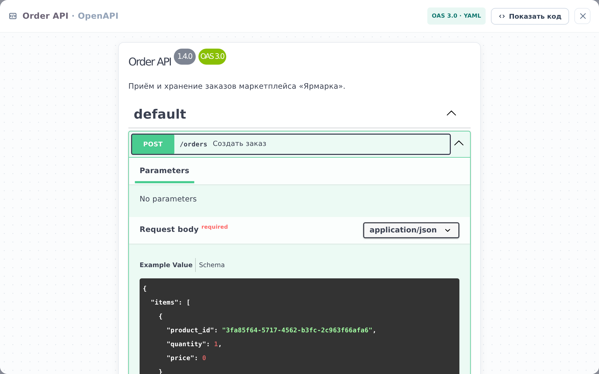

::: note
Спецификация OpenAPI описывает HTTP-API сервиса: эндпоинты, их параметры, тело запроса и ответы.
:::

## Открыть спецификацию

Чтобы просмотреть API сервиса, выполните следующие действия:

1. Откройте страницу сервиса (см. [Найти документацию сервиса](find-service.md)) и прокрутите до раздела **OpenAPI**.
2. В разделе **OpenAPI** нажмите **Спецификация**. Откроется окно со списком эндпоинтов.
3. В окне нажмите на нужный эндпоинт. Раскроются его параметры, тело запроса и ответы.
4. Закройте окно крестиком в правом верхнем углу или клавишей <kbd>Esc</kbd>.

::: note
Если раздела **OpenAPI** на странице сервиса нет, спецификация для него не описана.
:::

::: note
Окно только показывает спецификацию: отправить из него запрос к сервису нельзя.
:::

::: note
Кнопка **Показать код** в заголовке окна открывает исходный текст спецификации. Текст можно скопировать, но не изменить.
:::

::: note
У сервиса-контейнера раздел **OpenAPI** собирает спецификации его компонентов. Левая часть строки открывает спецификацию, правая часть **от …** ведёт на страницу компонента, которому она принадлежит.
:::

## Просмотреть логику эндпоинта

Чтобы просмотреть логику эндпоинта, выполните следующие действия:

1. В окне спецификации найдите эндпоинт и запомните его метод и путь, например **POST /orders**.
2. Закройте окно.
3. На странице сервиса в разделе **Логика** в списке **Операции** нажмите на схему, рядом с которой указан этот эндпоинт. Откроется окно со схемой (см. [Просмотреть логику операции или воркера](logic.md)).

::: note
Если в списке **Операции** нет схемы с нужным эндпоинтом, логика этого эндпоинта не описана.
:::
