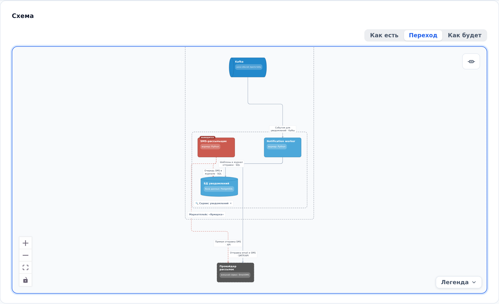

::: note
Архитектор отмечает у объекта статус: **Существует**, **Проектируется** (объект появится) или **Выводится** (объект уберут из эксплуатации). По этим статусам схема показывает систему сейчас, после изменений и переход между ними.
:::

## Узнать статус объекта

Чтобы узнать, затронут ли объект планируемыми изменениями, выполните следующие действия:

1. На схеме найдите объект с меткой над именем:
    - зелёный объект с меткой **новый** проектируется;
    - красный объект с меткой **выводится** выводится из эксплуатации.
2. Откройте страницу объекта. В разделе **Свойства** в строке **Статус** указан его статус.

::: note
Связи проектируемого объекта на схеме зелёные, выводимого красные.
:::

## Переключить вид схемы

Чтобы посмотреть систему до или после изменений, выполните следующие действия:

1. Над схемой на странице проекта, объекта или процесса выберите вид:
    - **Как есть**: то, что работает сейчас, включая выводимые объекты;
    - **Переход**: все объекты сразу, этот вид выбран по умолчанию;
    - **Как будет**: целевая система без выводимых объектов.
2. Посмотрите на схему. Объекты, которых в выбранном виде нет, остаются на месте, но становятся бледными.

::: note
Переключатель видов появляется, только если в проекте есть проектируемые или выводимые объекты.
:::

::: note
В бизнес-процессе вид так же приглушает шаги, участников которых в выбранном виде нет.
:::

::: note
Выбранный вид запоминается для каждого проекта отдельно в этом браузере.
:::
