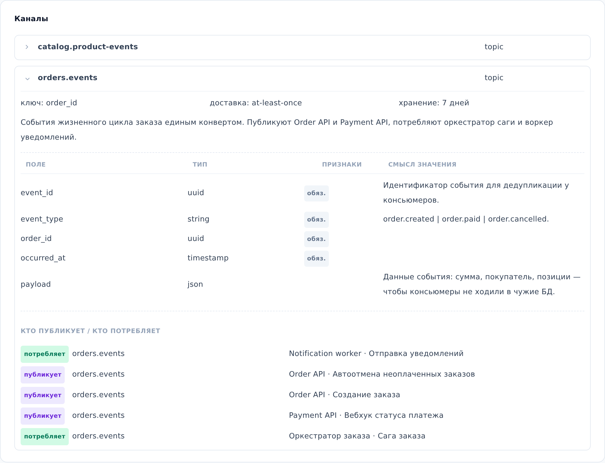

::: note
Каналы брокера сообщений связаны со схемами логики через пометки «публикует» и «потребляет» в шагах схем (см. [Просмотреть логику операции или воркера](logic.md)). По этим пометкам раздел **Каналы** показывает, какие сервисы и схемы публикуют сообщения в канал и потребляют их.
:::

## Просмотреть канал

Чтобы просмотреть каналы брокера сообщений, выполните следующие действия:

1. Откройте страницу брокера сообщений (см. [Найти документацию сервиса](find-service.md)) и прокрутите до раздела **Каналы**.
2. В разделе **Каналы** раскройте нужный канал. Для этого нажмите на стрелку слева от его имени. Появятся параметры доставки, поля сообщения и список **Кто публикует / кто потребляет**.
3. В списке **Кто публикует / кто потребляет** найдите сервисы и их схемы логики, которые публикуют сообщения в канал или потребляют их.

::: note
Канал в ArchMap означает то, что у брокера называется по-своему: topic в Kafka, queue или exchange в RabbitMQ, stream в Redis, subject в NATS. Вид канала указан справа от его имени.
:::

::: note
Строки списка **Кто публикует / кто потребляет** не открывают схемы логики. Схема открывается на странице сервиса в разделе **Логика** (см. [Просмотреть логику операции или воркера](logic.md)).
:::

::: note
Если в разделе написано **Каналы не описаны**, каналы брокера в проекте пока не задокументированы.
:::
