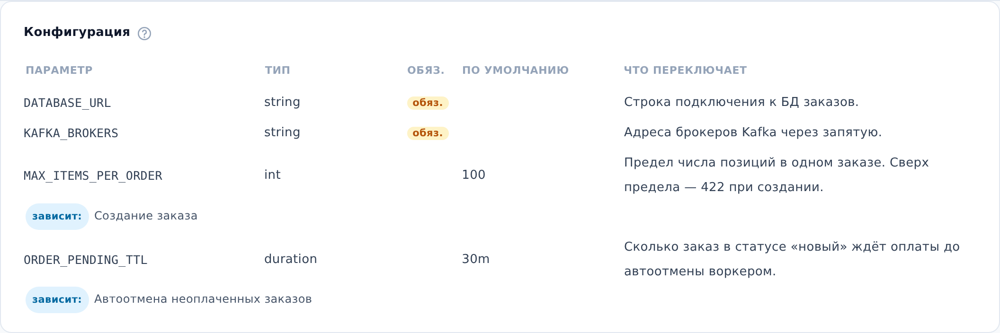

::: note
Параметры конфигурации сервиса связаны с его схемами логики через пометки «зависит от» в шагах схем (см. [Просмотреть логику операции или воркера](logic.md)). По этим пометкам раздел **Конфигурация** показывает, от каких параметров зависят схемы сервиса.
:::

## Просмотреть параметр

Чтобы просмотреть конфигурацию сервиса, выполните следующие действия:

1. Откройте страницу сервиса (см. [Найти документацию сервиса](find-service.md)) и прокрутите до раздела **Конфигурация**.
2. В разделе **Конфигурация** найдите нужный параметр.
3. Под параметром в строке **зависит:** прочитайте названия схем логики сервиса, шаги которых зависят от параметра.

::: note
В столбце **По умолчанию** указано значение из кода сервиса. Значения параметров в средах (тестовой, рабочей и других) ArchMap не хранит.
:::

::: note
Строка **зависит:** есть только у параметров, на которые ссылаются пометки «зависит от» в схемах логики этого же сервиса. Названия схем в этой строке не открываются. Открыть схему можно в разделе **Логика** на той же странице (см. [Просмотреть логику операции или воркера](logic.md)).
:::

::: note
Если в разделе написано **Параметры не описаны**, конфигурация сервиса в проекте пока не задокументирована.
:::
