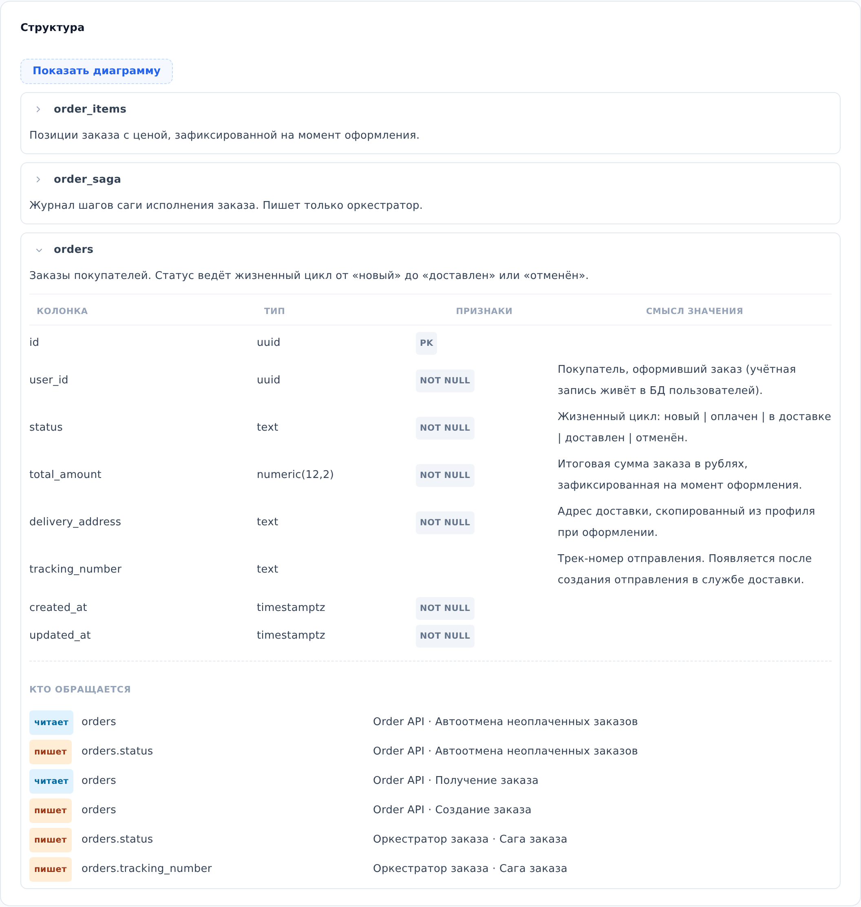

::: note
Таблицы базы данных связаны со схемами логики через пометки «читает» и «пишет» в шагах схем (см. [Просмотреть логику операции или воркера](logic.md)). По этим пометкам раздел **Структура** показывает, какие сервисы и схемы обращаются к таблице.
:::

## Просмотреть таблицу

Чтобы просмотреть структуру базы данных, выполните следующие действия:

1. Откройте страницу базы данных (см. [Найти документацию сервиса](find-service.md)) и прокрутите до раздела **Структура**.
2. В разделе **Структура** раскройте нужную таблицу. Для этого нажмите на стрелку слева от её имени. Появятся колонки таблицы и список **Кто обращается**.
3. В списке **Кто обращается** найдите строку с нужной таблицей или колонкой. В строке указаны сервис, который читает таблицу или пишет в неё, и схема логики, в которой описано это обращение.

::: note
Кнопка **Показать диаграмму** показывает связи таблиц ER-диаграммой. Нажмите на диаграмму, и она откроется во весь экран.
:::

::: note
Строки списка **Кто обращается** не открывают схемы логики. Схема открывается на странице сервиса в разделе **Логика** (см. [Просмотреть логику операции или воркера](logic.md)).
:::

::: note
Если в разделе написано **Таблицы не описаны**, структура базы в проекте пока не задокументирована.
:::
