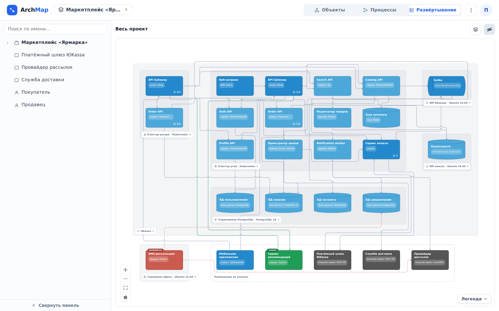

::: note
Площадка в ArchMap описывает место, где работают объекты системы: облако, кластер Kubernetes, виртуальная машина, физический сервер или что-то другое. Площадки вложены друг в друга, например кластер лежит внутри облака. Объект стоит на одной площадке или на нескольких сразу, по экземпляру на каждой. Площадки и размещение описывает архитектор (см. [Разместить объекты по площадкам](../architect/deployment.md)).
:::

## Открыть схему развёртывания

Чтобы открыть схему развёртывания, выполните следующие действия:

1. Откройте проект.
2. В шапке проекта в переключателе режимов выберите **Развёртывание**. Откроется схема развёртывания всего проекта, слева дерево объектов.

::: note
На схеме развёртывания:
- площадка показана зоной с подписью в левом нижнем углу (имя и технология); зона вложенной площадки лежит внутри зоны родителя;
- объект показан карточкой в зоне каждой площадки, где он стоит. Если объект стоит на нескольких площадках, у каждой его карточки есть пометка вида **1/2**: номер экземпляра и число площадок;
- контейнер, все компоненты которого стоят на одном и том же наборе площадок, показан одной карточкой с пунктирным контуром и числом компонентов. Если компоненты разошлись по площадкам, вместо контейнера показаны сами компоненты;
- объекты без размещения собраны в пунктирную группу **Размещение не указано**;
- стрелки идут между карточками так же, как на схеме объектов. Если у объекта несколько экземпляров, стрелка ведёт к ближайшему из них: на той же площадке или на площадке с тем же родителем. Равноудалённые экземпляры получают стрелку все;
- цвет карточки и метки **новый** и **выводится** те же, что на схеме объектов. Кнопка **Легенда** в углу схемы расшифровывает обозначения.
:::

::: note
Режим запоминается: в следующий раз проект откроется сразу в **Развёртывании**. К схеме объектов ведёт переключатель **Объекты**.
:::

## Найти объект на схеме развёртывания

Чтобы найти объект на схеме развёртывания, в дереве слева нажмите на объект. На схеме выделятся все его карточки, и схема подведёт их в кадр. Если объекта нет на текущем уровне, сначала откроется уровень его родителя.

Чтобы узнать размещение объекта с его страницы, откройте страницу объекта (см. [Перемещаться по уровням схемы](levels.md)). В разделе **Свойства** в строке **Размещение** перечислены площадки, где стоит объект; у вложенной площадки указан родитель, например **Кластер prod в Облако**. У контейнера перечислены площадки его компонентов, а если на площадке стоит только часть компонентов, рядом есть пометка **часть объектов**. Если размещение не указано, в строке написано **не указано**. У пользователя строки **Размещение** нет.

## Перейти на уровень контейнера

Чтобы посмотреть размещение компонентов одного контейнера, выполните одно из следующих действий:

- в дереве слева нажмите на контейнер;
- на схеме дважды нажмите на карточку контейнера.

Над схемой появится путь уровня, например **Весь проект › Сервис заказов**. На схеме останутся только компоненты этого контейнера, а площадки будут те же. Чтобы вернуться, в пути нажмите **Весь проект** или используйте кнопку «назад» браузера.

::: note
Двойное нажатие на карточку объекта (не контейнера) открывает его страницу. Уровень записан в адресе страницы, поэтому ссылкой на него можно поделиться (см. [Поделиться ссылкой на уровень или объект](share-link.md)).
:::

## Свернуть и раскрыть площадку

Чтобы свернуть площадку, на схеме нажмите на её подпись. Зона свернётся в карточку площадки: значок вида, имя и число объектов на ней на этом уровне. Стрелки к объектам внутри упрутся в карточку, а связи внутри площадки скроются.

Чтобы раскрыть площадку, нажмите лупу **Раскрыть содержимое** на её карточке или дважды нажмите на карточку.

::: note
Площадка, на которой на этом уровне ничего не стоит, сразу показана карточкой с подсказкой **Площадка пуста на этом уровне**. Группу **Размещение не указано** свернуть нельзя. У редактора проекта свёрнутость площадок сохраняется, у читателя действует до перезагрузки страницы.
:::

## Разобрать связи

Связи на схеме развёртывания разбирают так же, как на схеме объектов: двойное нажатие на стрелку или нажатие на её подпись подсвечивает связь и оба её объекта, а если на общем участке лежат несколько связей, откроется окно **Выберите связь** (см. [Просмотреть связи сервиса](edges.md)). Двойное нажатие на пустое место снимает подсветку.

::: note
Кнопка **Подписи связей** над схемой скрывает подписи стрелок, когда их слишком много. Настройка общая со схемой объектов и запоминается для каждого проекта отдельно в этом браузере. Кнопка **Площадки** открывает окно с деревом площадок проекта: вид, имя и технология каждой.
:::
