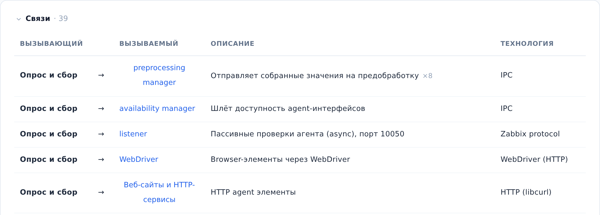

::: note
Связь в ArchMap направленная: от вызывающего объекта к вызываемому. У связи есть описание и технология; на схеме они стоят подписью у стрелки через точку (например, «Оформление и статусы заказов · REST»).
:::

## Просмотреть связи в таблице

Чтобы просмотреть связи сервиса в таблице, выполните следующие действия:

1. Откройте страницу сервиса (см. [Найти документацию сервиса](find-service.md)).
2. Прокрутите страницу до раздела **Связи**. Если раздел свёрнут, разверните его. Для этого нажмите на заголовок **Связи**.
3. В нужной строке нажмите на имя другого объекта. Откроется его страница.

::: note
Связи, у которых совпадают направление, объект снаружи, описание и технология, показаны одной строкой. После описания в ней стоит число таких связей (например, **×10**). С какими вложенными объектами связана каждая из них, видно на схеме (см. [Просмотреть связи на схеме](#просмотреть-связи-на-схеме)).
:::

::: note
В таблице только внешние связи: объекта и всех вложенных в него объектов с объектами снаружи. Связи между вложенными объектами смотрите на схеме, раскрыв объект лупой (см. [Перемещаться по уровням схемы](levels.md)), или на страницах самих вложенных объектов.
:::

::: note
Вид связи (вызов с ответом или сообщение через брокер) в таблице не показан. Определить его можно по технологии и по тому, идёт ли связь к брокеру сообщений.
:::

## Просмотреть связи на схеме

Чтобы увидеть связи сервиса на схеме, выполните следующие действия:

1. На странице сервиса в разделе **Схема** включите схему. Для этого нажмите на неё.
2. На схеме нажмите на сервис. Все его связи подсветятся.
3. Дважды нажмите на нужную стрелку. Связь подсветится по всей длине, включая общие участки с другими стрелками.
4. Если на стрелку легли несколько связей, откроется окно **Выберите связь**. В списке нажмите нужную связь. Если концы у связей разные, под описанием каждой указан объект на её конце (например, **→ Каталог**).
5. Дважды нажмите на объект на другом конце связи. Откроется его страница.

::: note
Несколько связей ложатся на одну стрелку, если у них общие концы на схеме (например, связи к разным объектам свёрнутой системы). Подпись такой стрелки перечисляет подписи этих связей, и одинаковые стоят в ней один раз. Поэтому и стрелка с одной подписью может нести несколько связей.
:::

::: note
Объекты с других уровней показаны на схеме пунктирной рамкой. Их страницы открываются так же, двойным нажатием.
:::

::: note
Если подписи стрелок мешают читать схему, скройте их кнопкой в правом верхнем углу схемы; та же кнопка возвращает подписи.
:::
