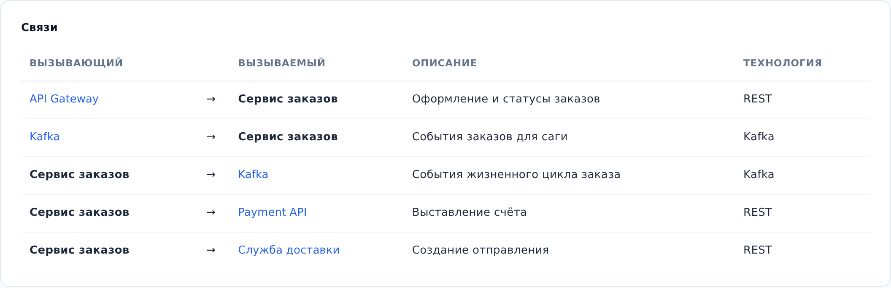

::: note
Связь в ArchMap направленная: от вызывающего объекта к вызываемому. У связи есть описание и технология; на схеме они стоят подписью у стрелки через точку, например «Оформление и статусы заказов · REST».
:::

## Просмотреть связи в таблице

Чтобы просмотреть связи сервиса в таблице, выполните следующие действия:

1. Откройте страницу сервиса (см. [Найти документацию сервиса](find-service.md)).
2. Прокрутите страницу до раздела **Связи**. Каждая строка таблицы описывает одну связь: кто вызывает, кого вызывает, описание и технология.
3. Нажмите на имя другого объекта в строке. Откроется его страница.

::: note
В таблице только внешние связи: сервиса и его компонентов с объектами снаружи. Связи между компонентами внутри сервиса смотрите на схеме, раскрыв сервис лупой (см. [Перемещаться по уровням схемы](levels.md)), или на страницах самих компонентов.
:::

::: note
Вид связи (вызов с ответом или сообщение через брокер) в таблице не показан: ориентируйтесь на технологию и на то, идёт ли связь к брокеру сообщений.
:::

## Просмотреть связи на схеме

Чтобы увидеть связи сервиса на схеме, выполните следующие действия:

1. На странице сервиса включите схему в разделе **Схема**. Для этого нажмите на неё.
2. Нажмите на сервис. Все его связи подсветятся.
3. Дважды нажмите на стрелку. Связь подсветится по всей длине, включая общие участки с другими стрелками.
4. Если по одной линии идёт несколько связей, откроется окно **Выберите связь**. Нажмите нужную связь в списке.
5. Дважды нажмите на объект на другом конце связи. Откроется его страница.

::: note
Объекты с других уровней показаны на схеме пунктирной рамкой. Их страницы открываются так же, двойным нажатием.
:::

::: note
Если подписи стрелок мешают читать схему, скройте их кнопкой в правом верхнем углу схемы; та же кнопка возвращает подписи.
:::
