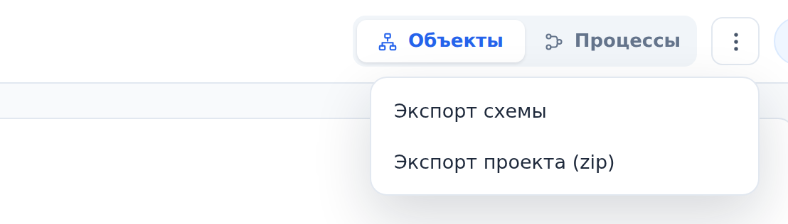

::: note
Экспорт выгружает знание проекта (например, чтобы передать схему ИИ-агенту или сохранить копию). Экспорт доступен всем, у кого есть доступ к проекту, в том числе читателям.
:::

## Выгрузить схему в YAML

Чтобы выгрузить схему в YAML, выполните следующие действия:

1. Откройте нужную страницу:
    - страницу проекта, чтобы выгрузить схему всего проекта;
    - страницу объекта, чтобы выгрузить объект вместе со всеми его компонентами.
2. В правом верхнем углу нажмите кнопку **Действия со схемой** (три точки). Откроется меню.
3. В меню выберите **Экспорт схемы** (на странице объекта пункт называется **Экспорт поддерева**). Откроется окно с текстом YAML.
4. В окне нажмите **Скопировать**. Текст скопируется в буфер обмена.

::: note
В YAML попадают объекты (имя, тип, роль, технология, описание, источник) и связи между ними. Схем логики, спецификаций, фактов и процессов в нём нет: они есть в архиве проекта.
:::

## Скачать архив проекта

Чтобы скачать архив проекта, выполните следующие действия:

1. Откройте страницу проекта.
2. В правом верхнем углу нажмите кнопку **Действия со схемой**.
3. В меню выберите **Экспорт проекта (zip)**. Браузер скачает архив.

::: note
Архив содержит всё знание проекта: схему, схемы логики, спецификации OpenAPI, структуры баз данных, каналы брокеров, конфигурацию и бизнес-процессы. Пункт **Экспорт проекта (zip)** есть только на странице проекта.
:::

::: note
Из архива можно восстановить проект в ArchMap. Это делает архитектор (см. [Экспортировать и импортировать проект](../architect/export-import.md)).
:::

## Выгрузить бизнес-процесс в Mermaid

Чтобы выгрузить бизнес-процесс, выполните следующие действия:

1. Откройте процесс (см. [Просмотреть бизнес-процесс](processes.md)).
2. В правом верхнем углу нажмите кнопку **Действия со схемой**.
3. В меню выберите **Экспорт процесса «…» (Mermaid)**. Откроется окно с текстом диаграммы в нотации Mermaid.
4. В окне нажмите **Скопировать**.
