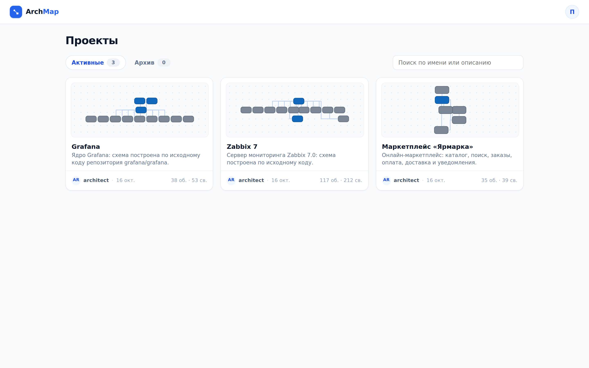
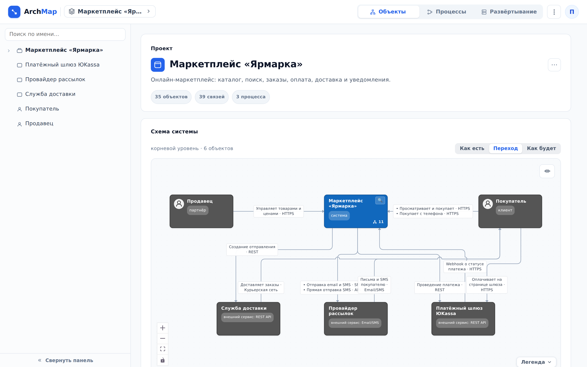

::: note
Проект в ArchMap описывает одну систему: её объекты, связи между ними, документацию и бизнес-процессы. Проект показывается всем его участникам, а если владелец открыл его всем пользователям, то каждому, кто вошёл в сервис. Проект, в который вас не добавили, в списке не появится и по прямой ссылке не откроется. Участников добавляет владелец проекта (см. [Открыть проект участникам и назначить роли](../architect/access.md)).
:::

## Найти проект

Чтобы найти проект, выполните следующие действия:

1. Войдите в ArchMap. Откроется экран **Проекты** со списком проектов, доступных вам.
2. Если проектов много, введите часть названия или описания в поле **Поиск по имени или описанию**. Список сузится по мере ввода.
3. Нажмите на карточку проекта. Откроется страница проекта.

::: note
Архивный проект (вкладка **Архив**) не открывается, пока владелец его не восстановит.
:::

::: note
Если вы перешли по ссылке на страницу внутри проекта, после входа откроется она. К списку проектов ведёт логотип **ArchMap** в левом верхнем углу.
:::

Чтобы перейти в другой проект, не возвращаясь к списку, выполните следующие действия:

1. Нажмите на название проекта в шапке. Раскроется список проектов.
2. Выберите проект одним из способов:
    - нажмите на него в списке;
    - введите часть названия в поле **Поиск проекта** и нажмите на найденный проект.

## Просмотреть устройство системы

Чтобы просмотреть устройство системы, выполните следующие действия:

1. Откройте страницу проекта. Раздел **Схема системы** показывает корневой уровень: системы верхнего уровня и связи между ними.
2. Включите схему. Для этого нажмите на неё.
3. Подберите масштаб и положение схемы одним из способов:
    - колесом измените масштаб;
    - перетащите схему за пустое место;
    - нажмите кнопки в левом нижнем углу схемы.
4. Нажмите на объект. Объект выделится, все его связи подсветятся.
5. Нажмите лупу **Раскрыть содержимое** на объекте-контейнере. Внутри его рамки появятся компоненты контейнера, связи протянутся к ним. Кнопка **Свернуть** в углу рамки скрывает их.
6. Дважды нажмите на стрелку. Связь подсветится по всей длине. Если по одной линии идёт несколько связей, ArchMap предложит выбрать нужную.
7. Нажмите <kbd>Esc</kbd> или кликните вне схемы. Схема снова станет неподвижной.

::: note
Кнопка **Легенда** в правом нижнем углу схемы объясняет формы объектов, цвета статусов и рамки. Кнопка в правом верхнем углу скрывает и возвращает подписи связей.
:::

::: note
Если в проекте описаны планируемые изменения, над схемой появляется переключатель **Как есть** / **Переход** / **Как будет** (см. [Просмотреть планируемые изменения системы](changes.md)).
:::

::: note
Если проект правят другие участники, схема на странице обновляется сама, над ней на несколько секунд появляется подпись **Схема обновлена в другой сессии**.
:::

Чтобы просмотреть список бизнес-процессов системы, выполните следующие действия:

1. Прокрутите страницу проекта до раздела **Бизнес-процессы**.
2. Нажмите на строку процесса. Проект переключится в режим **Процессы**, откроется выбранный процесс (см. [Просмотреть бизнес-процесс](processes.md)).

::: note
Раздела **Бизнес-процессы** нет, если процессов в проекте ещё не описали.
:::

## Перейти на первый уровень

Чтобы перейти с корневой схемы на уровень объекта, откройте страницу объекта одним из способов:

- дважды нажмите на объект на схеме;
- нажмите на объект в дереве слева.

::: note
Как перемещаться дальше по уровням, описано в разделе [Перемещаться по уровням схемы](levels.md). Конкретный сервис можно найти поиском, не спускаясь по уровням (см. [Найти документацию сервиса](find-service.md)).
:::
