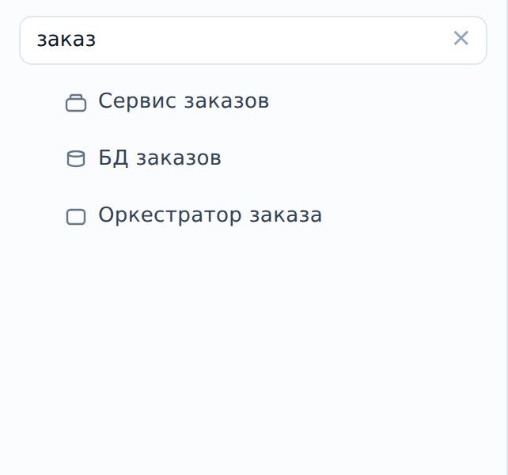

::: note
Документация сервиса собрана на его странице: свойства, схема, связи, логика операций, API, факты из кода и участие в бизнес-процессах. В интерфейсе объект ищут по имени. Поиск по содержимому документации (по тексту схем логики, таблицам, каналам и параметрам) доступен только ИИ-агенту, подключённому к ArchMap по MCP (см. [Задать вопрос о системе ИИ-агенту](agent-ask.md)).
:::

## Найти сервис по имени

Чтобы найти сервис по имени, выполните следующие действия:

1. Откройте проект.
2. В поле **Поиск по имени…** над деревом объектов введите часть имени. Под полем появится список объектов, в имени которых есть введённое.
3. В списке нажмите на нужный объект. Откроется его страница.

::: note
Список находок не показывает, где объект лежит в дереве. Путь от корня проекта виден вверху страницы объекта.
:::

::: note
Если имя неизвестно, спуститесь к сервису по уровням от страницы проекта (см. [Перемещаться по уровням схемы](levels.md)).
:::

## Найти нужный раздел на странице сервиса

Чтобы найти нужную документацию на странице сервиса, прокрутите страницу до раздела, который отвечает на ваш вопрос:

- с кем и как сервис обменивается данными: раздел **Связи** (см. [Просмотреть связи сервиса](edges.md));
- как устроена операция или воркер: раздел **Логика** (см. [Просмотреть логику операции или воркера](logic.md));
- какие операции есть у API сервиса: раздел **OpenAPI** (см. [Просмотреть API сервиса](api.md));
- какие параметры читает сервис: раздел **Конфигурация** (см. [Просмотреть конфигурацию сервиса](config.md));
- в каких бизнес-процессах участвует сервис: раздел **Участвует в процессах** (см. [Просмотреть бизнес-процесс](processes.md));
- где лежит код сервиса: в разделе **Свойства** поле **Источник** (см. [Найти репозиторий и путь к коду сервиса](source.md));
- где сервис развёрнут: в разделе **Свойства** строка **Размещение** (см. [Посмотреть, где развёрнуты объекты](deployment.md)).

::: note
Набор разделов зависит от типа объекта. У сервиса есть **Логика**, **OpenAPI** и **Конфигурация**; у базы данных вместо них раздел **Структура** с таблицами (см. [Просмотреть структуру базы данных](db.md)); у брокера сообщений раздел **Каналы** (см. [Просмотреть каналы брокера](channels.md)); у пользователя только **Свойства**, **Схема**, **Связи** и **Участвует в процессах**. Разделы **Логика**, **OpenAPI** и **Участвует в процессах** скрываются, если в них ничего не описано; разделы фактов остаются с подписью «не описаны».
:::

::: note
У сервиса-контейнера разделы **Логика** и **OpenAPI** собирают документацию его компонентов, сгруппированную по компонентам.
:::

::: note
Рядом с именем объекта стоит пилюля статуса страницы: жёлтая **В работе** или зелёная **Согласовано**. Это статус документации, его ставит редактор проекта (см. [Согласовать страницу объекта](../architect/approve.md)); у контейнера пилюля показывает, сколько компонентов согласовано, и раскрывает их список. Кнопка **⋯** справа от имени открывает пункты **Открыть в карте** и **Версии документации** (см. [Посмотреть прежние версии документации](versions.md)).
:::
