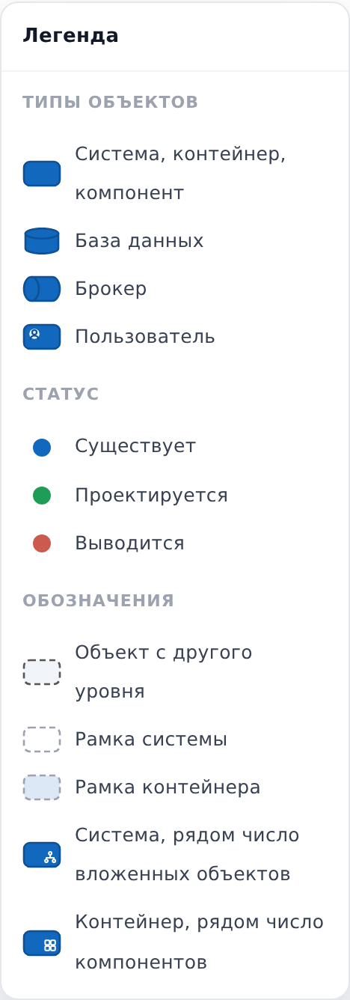
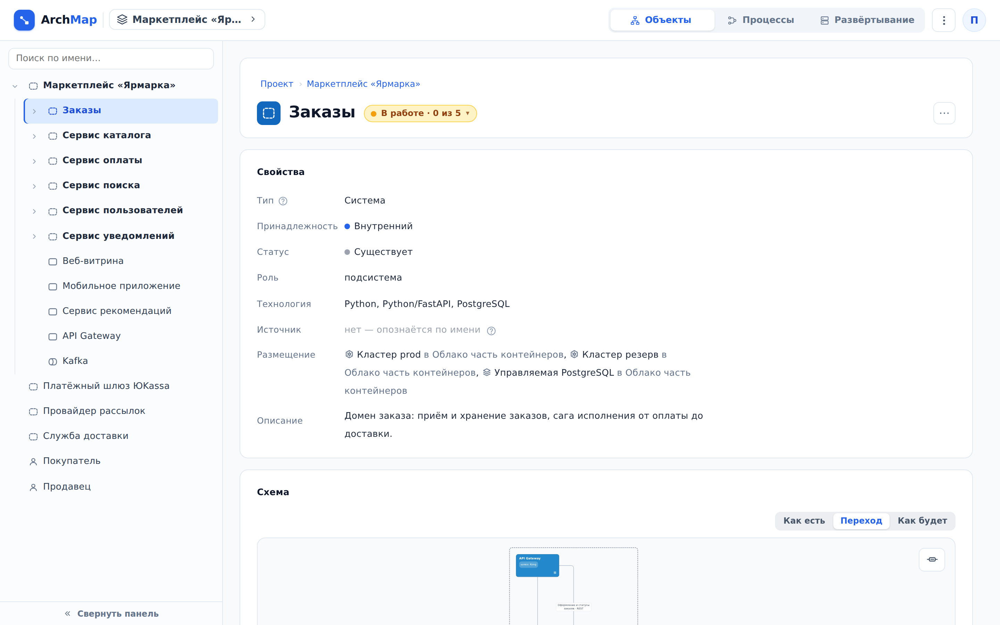
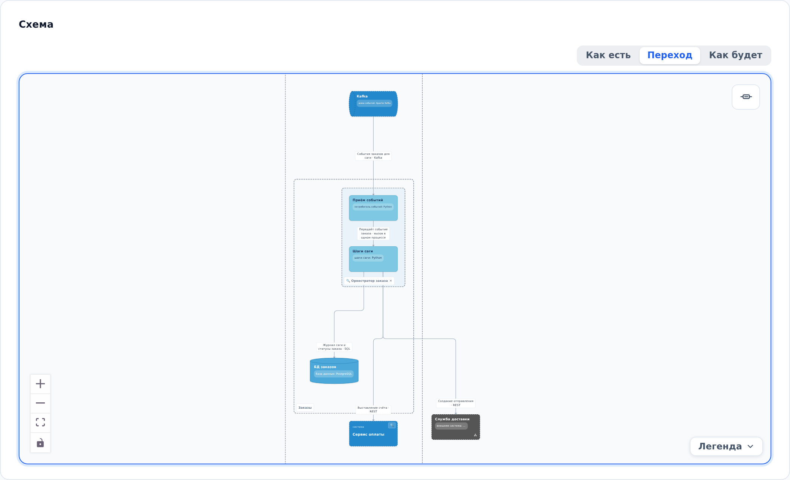

::: note
Проект в ArchMap устроен как дерево объектов. [Система](../glossary.md#system) состоит из других систем, [контейнеров](../glossary.md#container), баз данных и брокеров, а контейнер состоит из [компонентов](../glossary.md#component). У базы данных, брокера и пользователя вложенных объектов не бывает. Например, система «Заказы» содержит контейнер «Оркестратор заказа», а он содержит компоненты «Приём событий» и «Шаги саги». [Уровень](../glossary.md#level) состоит из объектов, вложенных в одну систему или один контейнер, и связей между ними. Корневой уровень показан на странице проекта, остальные уровни открываются со страниц объектов.
:::

::: note
Тип объекта на схеме видно по форме блока и знаку в его правом нижнем углу:
- у системы знак в виде дерева, рядом число вложенных объектов;
- у контейнера знак в виде сетки, рядом число компонентов;
- у компонента, базы данных, брокера и пользователя знака нет.

Раскрытая система обведена пунктирной рамкой, раскрытый контейнер обведён такой же рамкой с заливкой. Кнопка **Легенда** в углу схемы расшифровывает формы, цвета и знаки.
:::

## Открыть страницу объекта

Чтобы открыть страницу объекта, выполните одно из следующих действий:

- на схеме страницы проекта или другого объекта дважды нажмите на нужный объект;
- в дереве слева нажмите на нужный объект;
- в поле **Поиск по имени** над деревом введите часть имени и нажмите на найденный объект.

::: note
На схеме страницы объекта показаны:
- сам объект;
- соседи с того же уровня, с которыми он связан (сплошной рамкой);
- соседи с других уровней (пунктирной рамкой);
- связи между всеми ними, включая связи соседей друг с другом;
- пунктирная рамка объекта, в который он вложен.

Объекты того же уровня, с которыми объект не связан, на его схему не попадают. Их видно на схеме родителя.
:::

::: note
Ниже схемы на странице объекта расположены разделы **Связи**, **Логика**, **OpenAPI** и **Участвует в процессах** (см. [Просмотреть связи сервиса](edges.md), [Просмотреть логику операции или воркера](logic.md), [Просмотреть API сервиса](api.md), [Просмотреть бизнес-процесс](processes.md)).
:::

## Спуститься на уровень ниже

Чтобы просмотреть вложенные объекты системы или компоненты контейнера, не покидая схему, выполните следующие действия:

1. На схеме найдите систему или контейнер. Их можно узнать по лупе **Раскрыть содержимое** в правом верхнем углу блока.
2. Нажмите лупу. Внутри рамки появятся вложенные объекты, стрелки протянутся к ним.
3. Если нужно спуститься ещё глубже, нажмите лупу на вложенной системе или вложенном контейнере.
4. Скройте вложенные объекты. Для этого в углу рамки нажмите **Свернуть**.

::: note
Так можно раскрыть систему или контейнер и на странице проекта, и на странице любого объекта.
:::

::: note
Подряд можно раскрыть только два уровня. Глубже лупа неактивна, а подсказка на ней предлагает войти в объект. Для этого дважды нажмите на него, и откроется его страница.
:::

Чтобы перейти на уровень вложенного объекта, выполните следующие действия:

1. Раскройте систему или контейнер лупой **Раскрыть содержимое**.
2. Дважды нажмите на нужный объект. Откроется его страница со схемой его уровня.

## Вернуться на уровень выше

Чтобы вернуться на уровень выше, выполните одно из следующих действий:

- вверху страницы объекта в пути **Проект › …** нажмите на имя нужного предка;
- вернитесь на страницу проекта к корневому уровню. Для этого в начале того же пути нажмите **Проект**;
- в дереве слева нажмите на нужного предка.

## Пользоваться деревом объектов

Чтобы найти объект в дереве слева, выполните следующие действия:

1. Слева от имени системы или контейнера нажмите на стрелку. Ветка раскроется.
2. Нажмите на имя нужного объекта. Откроется его страница.

::: note
Дерево само раскрывается до объекта, страница которого открыта. Кнопка **Свернуть панель** внизу прячет дерево, **Развернуть панель** возвращает его. В режиме **Развёртывание** то же дерево ведёт по уровням схемы развёртывания (см. [Посмотреть, где развёрнуты объекты](deployment.md)).
:::

::: note
Поле **Поиск по имени** над деревом ищет только по именам объектов. Поиск по всей документации проекта описан в разделе [Найти документацию сервиса](find-service.md).
:::
