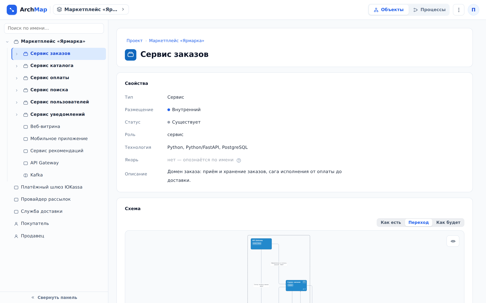
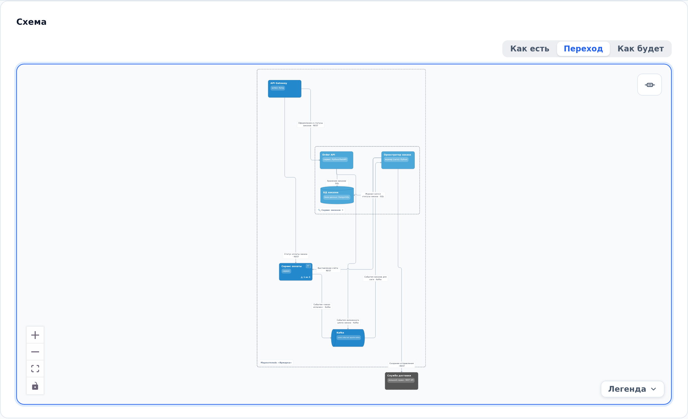

::: note
Проект в ArchMap — дерево объектов. Объект, у которого есть части, называется контейнером: контейнером может быть только сервис, а база данных, брокер и пользователь — атомарные объекты. Уровень — это части одного контейнера и связи между ними. Корневой уровень показан на странице проекта, остальные уровни открываются со страниц объектов.
:::

## Открыть страницу объекта

Чтобы открыть страницу объекта, выполните одно из следующих действий:

- дважды нажмите на объект на схеме — на странице проекта или на странице другого объекта;
- нажмите на объект в дереве слева;
- введите часть имени в поле **Поиск по имени…** над деревом и нажмите на найденный объект.

::: note
На странице объекта:
- вверху — хлебные крошки **Проект › …** с путём от корня до объекта и имя объекта;
- карточка **Свойства** — тип, размещение, роль, технология, статус и якорь объекта в коде;
- карточка **Схема** — сам объект, его соседи и связи с ними;
- ниже — карточки **Связи**, **Логика**, **OpenAPI** и **Участвует в процессах** (см. [Просмотреть связи сервиса](edges.md), [Просмотреть логику операции или воркера](logic.md), [Просмотреть API сервиса](api.md), [Просмотреть бизнес-процесс](processes.md)).
:::

::: note
На схеме страницы объекта показаны:
- сам объект;
- соседи с того же уровня, с которыми он связан, — сплошной рамкой;
- соседи с других уровней — пунктирной рамкой;
- связи между всеми ними, включая связи соседей друг с другом;
- рамка родительского контейнера — пунктиром, его имя подписано в углу рамки.

Объекты того же уровня, с которыми объект не связан, на его схему не попадают — их видно на схеме родителя.
:::

## Спуститься на уровень ниже

Чтобы просмотреть части контейнера, не покидая схему, выполните следующие действия:

1. Найдите контейнер на схеме. У контейнера есть лупа **Раскрыть содержимое** и счётчик частей.
2. Нажмите лупу. Внутри рамки контейнера появятся его части, стрелки протянутся к ним. Схема заново впишется в окно.
3. Чтобы спуститься ещё глубже, нажмите лупу на любой части-контейнере.
4. Чтобы убрать части обратно, нажмите **Свернуть** (крестик рядом с именем контейнера в углу рамки).

::: note
Так можно раскрыть контейнер и на странице проекта, и на странице любого объекта. Схема страницы объекта всегда открывается со свёрнутым объектом: сначала видны только он сам и его соседи.
:::

::: note
Подряд можно раскрыть только два уровня: глубже лупа становится неактивной и подсказывает спуститься на страницу части.
:::

Чтобы перейти на уровень части, выполните следующие действия:

1. Раскройте контейнер лупой **Раскрыть содержимое**.
2. Дважды нажмите на часть. Откроется её страница со схемой её уровня.

## Вернуться на уровень выше

Чтобы вернуться на уровень выше, выполните одно из следующих действий:

- нажмите на имя предка в хлебных крошках **Проект › …** вверху страницы объекта;
- нажмите **Проект** в тех же крошках, чтобы вернуться к корневому уровню на странице проекта;
- нажмите на предка в дереве слева.

## Пользоваться деревом объектов

Чтобы найти объект в дереве слева, выполните следующие действия:

1. Нажмите на стрелку слева от имени контейнера. Ветка раскроется, схема при этом не изменится.
2. Нажмите на имя объекта. Откроется его страница, а строка объекта подсветится в дереве.

::: note
В дереве:
- значок перед именем показывает форму объекта: сервис, база данных, брокер сообщений, пользователь;
- дерево само раскрывается до объекта, страница которого открыта;
- кнопка **Свернуть панель** внизу превращает дерево в узкую полосу, кнопка **Развернуть панель** возвращает его.
:::

::: note
Поле **Поиск по имени…** над деревом ищет только по именам объектов. Поиск по всей документации проекта описан в разделе [Найти документацию сервиса](find-service.md).
:::
