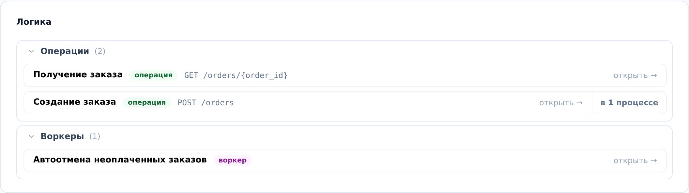
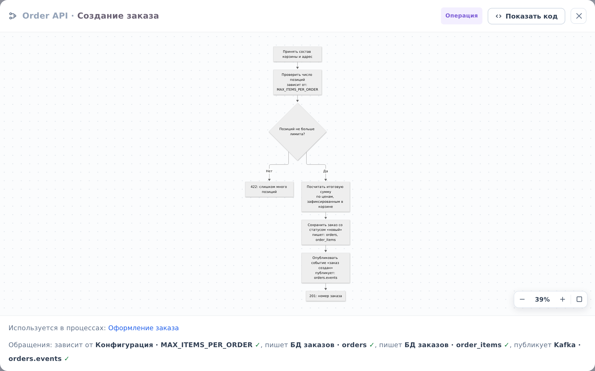

::: note
Схема логики описывает по шагам одну операцию сервиса (обработчик запроса или сценарий) либо воркер (фоновую работу): что сервис принимает, что проверяет, куда пишет и что отвечает. Схема операции может быть привязана к эндпоинту из спеки OpenAPI сервиса.
:::

## Открыть схему логики

Чтобы просмотреть логику операции или воркера, выполните следующие действия:

1. Откройте страницу сервиса (см. [Найти документацию сервиса](find-service.md)) и прокрутите до раздела **Логика**. Схемы сгруппированы в списки **Операции** и **Воркеры**; рядом со схемой операции указан эндпоинт, который она обрабатывает.
2. В списке нажмите на нужную схему. Откроется окно со схемой.

::: note
На случай, если у сервиса много схем, списки **Операции** и **Воркеры** можно свернуть и развернуть стрелкой слева от заголовка.
:::

::: note
Кнопка **в N процессах** справа от схемы показывает, шаги каких бизнес-процессов задокументированы этой схемой. Нажмите её, затем нажмите на процесс в раскрывшемся списке, и он откроется (см. [Просмотреть бизнес-процесс](processes.md)).
:::

## Прочитать схему

Чтобы прочитать схему в открывшемся окне, выполните следующие действия:

1. Пройдите по шагам сверху вниз по стрелкам. Ромб обозначает проверку, от него идут ветки **Да** и **Нет**.
2. Подберите масштаб. Для этого используйте колесо мыши или кнопки в правом нижнем углу окна: уменьшить, увеличить, вписать схему в окно. Перетаскиванием сдвиньте схему.
3. Прочитайте строку **Обращения** под схемой: к каким таблицам, каналам брокера и параметрам конфигурации обращаются шаги. Пометки «читает», «пишет», «публикует», «потребляет» и «зависит от» стоят и в самих шагах схемы (см. [Просмотреть структуру БД, каналы брокера и конфигурацию сервиса](facts.md)).
4. Строка **Используется в процессах** ведёт к бизнес-процессам, в которых эта операция является шагом. Нажмите на название процесса, и он откроется.
5. Закройте окно крестиком в правом верхнем углу или клавишей <kbd>Esc</kbd>.

::: note
Кнопка **Показать код** в заголовке окна открывает исходный текст схемы в нотации Mermaid. Текст можно скопировать, но не изменить.
:::

::: note
Галочка после обращения означает, что таблица, канал или параметр найдены в документации проекта; значок предупреждения с пояснением означает, что по пометке ничего не нашлось.
:::

::: note
Блок **Не описано** под чертой в разделе **Логика** перечисляет операции и воркеры, которые ИИ-агент нашёл в коде, но схемы для которых ещё не написаны. Открыть такую строку можно, но схемы в ней пока нет.
:::

::: note
У сервиса-контейнера раздел **Логика** собирает схемы его компонентов, сгруппированные по компонентам. Левая часть строки открывает схему, правая часть **от …** ведёт на страницу компонента, которому схема принадлежит.
:::
