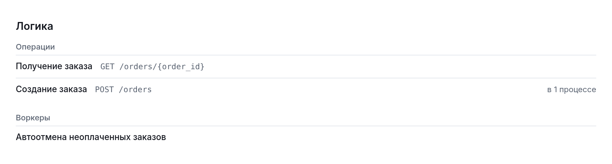
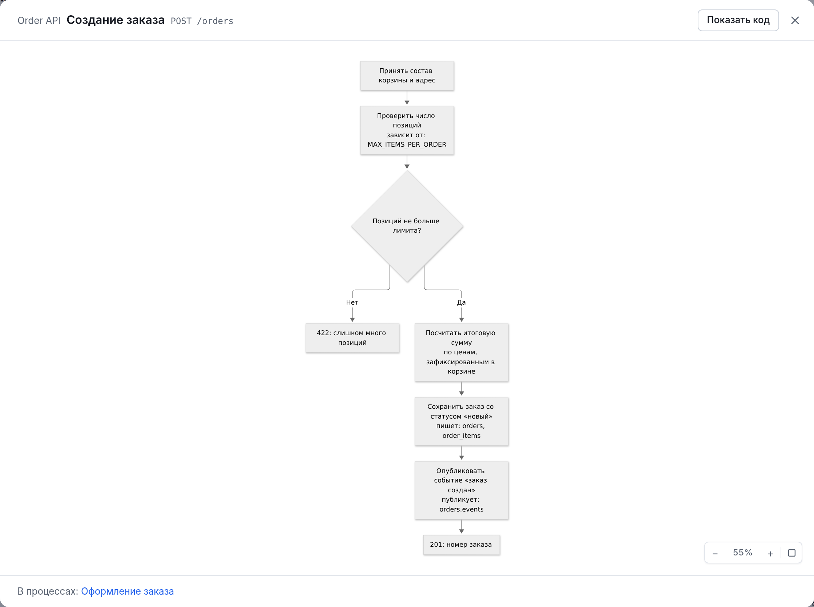

::: note
[Схема логики](../glossary.md#logic) описывает по шагам одну операцию сервиса (обработчик запроса или сценарий) либо воркер (фоновую работу): что сервис принимает, что проверяет, куда пишет и что отвечает. Схема операции может быть привязана к эндпоинту из спецификации OpenAPI сервиса.
:::

## Открыть схему логики

Чтобы просмотреть логику операции или воркера, выполните следующие действия:

1. Откройте страницу сервиса (см. [Найти документацию сервиса](find-service.md)) и прокрутите до раздела **Логика**. Схемы сгруппированы в списки **Операции** и **Воркеры**; рядом со схемой операции указан эндпоинт, который она обрабатывает.
2. В списке нажмите на нужную схему. Откроется окно со схемой.

::: note
Кнопка **в N процессах** справа от схемы показывает, шаги каких бизнес-процессов задокументированы этой схемой. Нажмите её, затем нажмите на процесс в раскрывшемся списке, и он откроется (см. [Просмотреть бизнес-процесс](processes.md)).
:::

## Прочитать схему

Чтобы прочитать схему в открывшемся окне, выполните следующие действия:

1. Пройдите по шагам сверху вниз по стрелкам. Ромб обозначает проверку, от него идут ветки **Да** и **Нет**.
2. Подберите масштаб одним из способов:
    - в правом нижнем углу окна нажмите кнопки масштаба;
    - поверните колесо, удерживая <kbd>Ctrl</kbd>.
3. Прокрутите схему колесом или перетащите её.
4. Прочитайте пометки «читает», «пишет», «публикует», «потребляет» и «зависит от» в шагах схемы. Они называют таблицы, каналы брокера и параметры конфигурации, к которым обращается шаг (см. [Просмотреть структуру базы данных](db.md), [Просмотреть каналы брокера](channels.md), [Просмотреть конфигурацию сервиса](config.md)).
5. Под схемой в строке **В процессах:** нажмите на название процесса. Откроется процесс, шаг которого описывает эта схема.
6. Закройте окно крестиком в правом верхнем углу или клавишей <kbd>Esc</kbd>.

::: note
Кнопка **Показать код** в заголовке окна открывает исходный текст схемы в нотации Mermaid, его можно скопировать.
:::

::: note
Если таблицы, канала или параметра из пометки нет в документации проекта, под схемой появится строка с предупреждением.
:::

::: note
Блок **Не описано** под чертой в разделе **Логика** перечисляет операции и воркеры, которые ИИ-агент нашёл в коде, но схемы для которых ещё не написаны. Открыть такую строку можно, но схемы в ней пока нет.
:::

::: note
У контейнера с компонентами раздел **Логика** показывает и схемы компонентов, группами под именами компонентов.
:::
