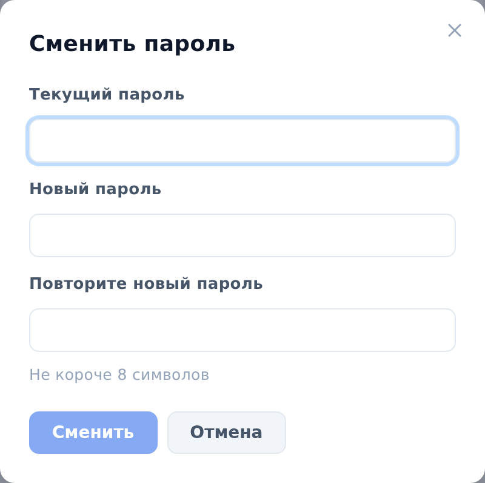

## Сменить пароль

Чтобы сменить пароль, выполните следующие действия:

1. В правом верхнем углу любой страницы нажмите на кружок профиля. Откроется меню профиля.
2. В меню выберите **Сменить пароль**. Откроется окно **Сменить пароль**.
3. В поле **Текущий пароль** введите действующий пароль.
4. В полях **Новый пароль** и **Повторите новый пароль** введите новый пароль. Он должен быть не короче 8 символов.
5. Нажмите **Сменить**. Появится сообщение **Пароль изменён**.
6. Нажмите **Готово**.

::: note
Текущий сеанс продолжается: новый пароль понадобится при следующем входе.
:::

::: note
Если вы забыли пароль, попросите администратора ArchMap задать новый (см. [Сбросить пароль пользователя](../admin/reset-password.md)).
:::

::: note
На демонстрационном стенде у гостя меню профиля нет, и пароль сменить нельзя.
:::
