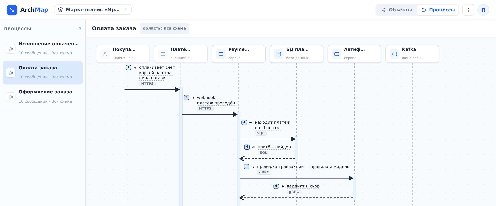

::: note
Бизнес-процесс показывает по шагам, как сервисы взаимодействуют в одном сценарии (например, при оплате заказа): кто кого вызывает, что отвечает и какие события публикует. Процесс изображён диаграммой последовательности: участники стоят сверху, шаги идут сверху вниз.
:::

## Открыть процесс

Чтобы открыть бизнес-процесс, выполните следующие действия:

1. Откройте проект (см. [Найти проект и просмотреть устройство системы](find-project.md)).
2. В правом верхнем углу нажмите **Процессы**. Слева откроется список процессов проекта.
3. В списке нажмите на нужный процесс. Справа появится его диаграмма.

::: note
Процесс можно открыть и с других страниц:
- на странице проекта в разделе **Бизнес-процессы**;
- на странице сервиса в разделе **Участвует в процессах**;
- в окне схемы логики в строке **Используется в процессах**.

К схеме системы возвращает кнопка **Объекты** в правом верхнем углу.
:::

## Прочитать диаграмму

Чтобы прочитать диаграмму процесса, выполните следующие действия:

1. Пройдите по шагам в порядке номеров. Вид стрелки показывает тип шага:
    - сплошная линия и закрашенный наконечник: вызов;
    - пунктирная линия: ответ на вызов;
    - сплошная линия и открытый наконечник: событие (например, публикация сообщения в брокер).
2. На диаграмме откройте схему логики нужного шага. Для этого нажмите на его подчёркнутую подпись. Откроется окно со схемой логики операции, которая выполняет шаг (см. [Просмотреть логику операции или воркера](logic.md)).
3. Над диаграммой откройте страницу нужного участника. Для этого наведите курсор на его имя и нажмите на появившуюся стрелку. Откроется страница объекта.

::: note
Подпись шага без подчёркивания не открывается: схема логики к этому шагу не привязана.
:::

::: note
Рамка с меткой в левом верхнем углу объединяет шаги, которые выполняются по особому правилу:
- **alt**: выполняется одна из веток, условие каждой ветки подписано в рамке;
- **opt**: шаги выполняются, только если выполнено условие;
- **loop**: шаги повторяются;
- **par**: шаги выполняются параллельно.
:::

::: note
Шаг, зачёркнутый красным, расходится со схемой системы:
- **связь удалена**: связи, по которой шёл шаг, больше нет;
- **канал без ответа**: шаг описывает ответ, а связь стала асинхронной и ответа не предполагает.
:::

::: note
Метка **область** рядом с названием процесса показывает, в пределах какой части системы описан процесс. **Вся схема** означает, что процесс охватывает весь проект.
:::

::: note
Если в процессе участвуют планируемые или выводимые объекты, над диаграммой появляется переключатель **Как есть** / **Переход** / **Как будет** (см. [Просмотреть планируемые изменения системы](changes.md)).
:::
