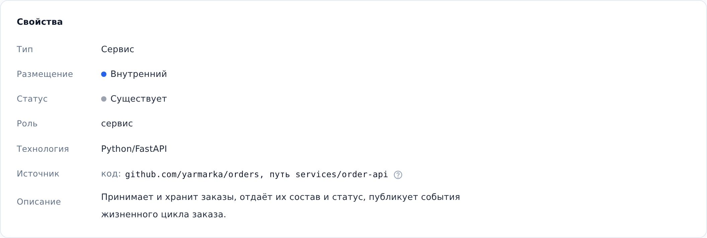

::: note
Источник объекта показывает, где лежит его код: репозиторий и путь в нём. У зависимости без кода в продукте (базы данных, брокера, соседнего продукта) источник указывает имя, под которым продукт называет её в своих настройках. По источнику ArchMap узнаёт объект, когда документация обновляется из кода.
:::

## Найти код сервиса

Чтобы найти репозиторий и путь к коду сервиса, выполните следующие действия:

1. Откройте страницу сервиса (см. [Найти документацию сервиса](find-service.md)).
2. В разделе **Свойства** найдите строку **Источник**. В ней указано одно из следующего:
    - **код:** репозиторий и путь к каталогу сервиса в нём; если пути нет, сервису соответствует весь репозиторий;
    - **имя зависимости:** имя, под которым продукт называет объект в своих настройках (например, в docker-compose); кода этого объекта в продукте нет;
    - **нет — опознаётся по имени:** источник не указан.
3. Скопируйте адрес репозитория и откройте его в браузере.
4. В репозитории перейдите в каталог, указанный после слова **путь**.

::: note
У объектов, которые ИИ-агент описал по коду, источник заполняется автоматически. У объектов, добавленных вручную, его может не быть.
:::

::: note
Источник описывает продукт, а не развёртывание: адресов серверов и сред в нём нет.
:::
