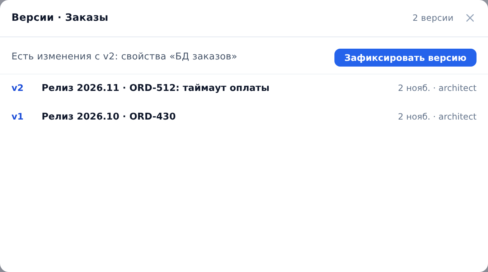
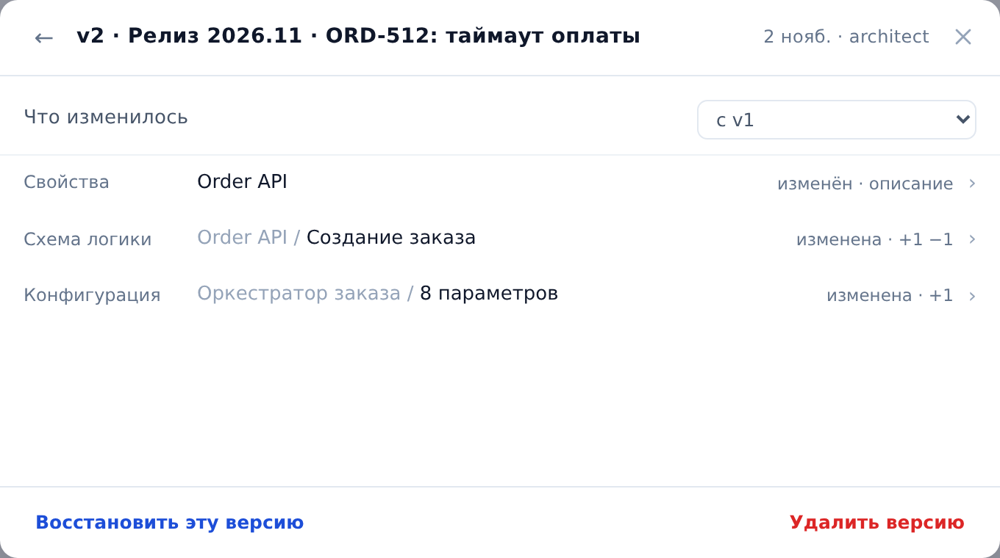

::: note
Редактор проекта время от времени фиксирует [версию документации](../glossary.md#version) объекта или всего проекта (см. [Зафиксировать версию документации и вернуться к ней](../architect/versions.md)). Читатель видит все версии и изменения между ними.
:::

## Открыть список версий

Чтобы открыть список версий, выполните следующие действия:

1. Откройте страницу объекта. Для версий всего проекта откройте страницу проекта.
2. Справа от имени нажмите кнопку **⋯** и выберите **Версии документации**. Откроется список версий.

::: note
Версии с комментариями **Перед откатом к vN** и **Откат к vN** ArchMap создаёт сам при возврате документации к прежней версии.
:::

## Посмотреть, что изменилось в версии

Чтобы посмотреть изменения, выполните следующие действия:

1. В списке версий нажмите на версию. Откроется экран версии со списком изменённых элементов.
2. В поле **С чем сравнивать** выберите, что показать:
    - **с vN−1**: изменения по сравнению с предыдущей версией;
    - **с текущим состоянием**: отличия версии от документации сейчас.
3. Нажмите на элемент. Откроется экран элемента с переключателем **Изменения · Было · Стало**: что изменилось, как было в версии и как стало.
4. Чтобы вернуться на предыдущий экран, нажмите кнопку **Назад**.

::: note
Вернуть документацию к прежней версии может только редактор проекта. Если нужна старая версия, обратитесь к нему или попросите ИИ-агента показать текст документации на нужной версии (см. [Задать вопрос о системе ИИ-агенту](agent-ask.md)).
:::
